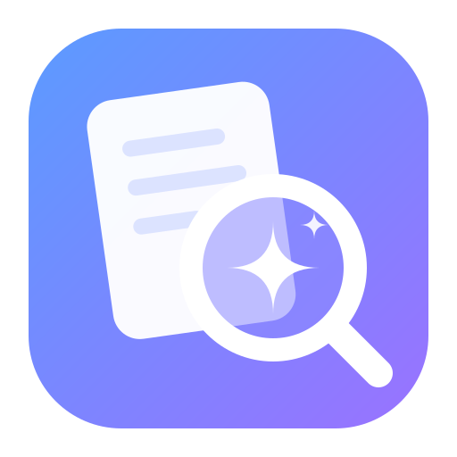
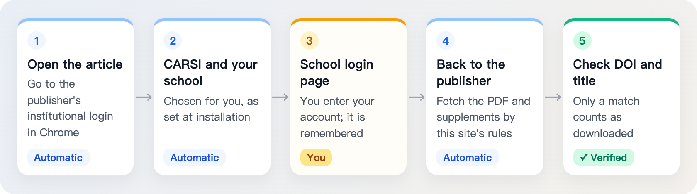

<p align="center">
  
</p>

<h1 align="center">PaperSearch</h1>

<p align="center"><b>A lightweight, fully automated all-in-one literature tool for AI</b><br>
Tell your AI tool once: it searches, verifies and downloads full texts and supplementary files through a deeply optimized flow in the background, without interrupting your work.</p>

<p align="center">
  <a href="https://www.npmjs.com/package/papersearch"></a>
  <a href="https://github.com/dr-dumpling/PaperSearch/actions/workflows/publish.yml"></a>
  <a href="https://nodejs.org/"></a>
  <a href="#1-school-subscription-downloads-carsi"></a>
  <a href="docs/guide.en.md#agent-skill"></a>
  <a href="#quick-start"></a>
  <a href="LICENSE"></a>
</p>

<p align="center">
  <a href="README.md">简体中文</a> · <a href="#quick-start">Quick start</a> · <a href="#1-school-subscription-downloads-carsi">School subscription downloads</a> · <a href="#2-api-keys">API keys</a> · <a href="docs/guide.en.md">Guide</a> · <a href="docs/ARCHITECTURE.zh.md">Architecture</a> · <a href="docs/ROADMAP.zh.md">Roadmap</a> · <a href="https://github.com/dr-dumpling/PaperSearch/issues/new/choose">Report an issue</a>
</p>

PaperSearch provides the `paper-search` command and a bundled Skill. Once installed, Claude Code, Codex, Cursor, Kimi Code, Qwen Code, CodeBuddy, TRAE and other AI tools that can run local commands can do this for you:

- **Search papers**: query more than 20 sources at once, including PubMed, Crossref, OpenAlex, Semantic Scholar and arXiv, with duplicates merged by DOI and DOIs verified.
- **Search full-text snippets**: search the paper bodies Semantic Scholar indexes for passages on methods or results, with their sources.
- **Look up journal IF and quartiles**: through EasyScholar, look up JCR impact factors, JCR quartiles and CAS zones.
- **Look up citations and references**: from one paper, find the studies that cite it and the works it cites.
- **Download full texts and supplementary files**: open-access papers download directly; other papers come through your school's subscriptions: install school subscription downloads (CARSI) to download them in batches through your school login, or add publisher API keys.

<!-- Demo GIF goes here once recorded; the overview picture then moves to "Reference · How it works" -->

<p align="center"></p>

## Quick start

### 1. Install

It needs Node.js 18 or later and npm. Either way:

- Yourself: copy one line (Codex as the example). For another AI tool, replace `codex` with `claude`, `cursor`, `gemini`, `antigravity` or `agents` (the shared `~/.agents/skills/` directory).

  ```sh
  npm install -g papersearch && paper-search skills update --targets codex
  ```

- Through your AI tool: send it this.

  ```text
  Please install PaperSearch: run npm install -g papersearch;
  then run paper-search skills update --targets <your type> to install
  the bundled Skill for yourself (codex, claude, cursor, gemini, antigravity or agents);
  finally run paper-search doctor --format text and tell me which features work.
  I will enter API keys myself with paper-search setup.
  ```

### 2. Tell your AI tool what you need

Start a new AI session and say what you need, for example:

| To do | You can say |
|---|---|
| Search papers | Find randomized trials of SGLT2 inhibitors in heart failure since 2020, and verify the DOIs |
| Search full-text snippets | How did these trials define their primary endpoint? Quote a few passages |
| Look up journal IF and quartiles | Which journals were they published in, and what are their impact factors and quartiles? |
| Look up citations and references | Which studies have cited the DAPA-HF trial since it was published? |
| Download full texts and supplementary files | Download the full texts and supplementary files of these papers to ./downloads |

### 3. Get the results

- Search results, snippets, journal metrics and citations come back in the conversation.
- Downloaded papers are organized into folders, and you are told why any paper was not obtained:

  ```text
  downloads/
  ├── papers/
  │   ├── Nutrients_2026_α-Ketoglutarate Alleviates the Pathogenesis…_0b6e0203de/
  │   │   ├── Nutrients_2026_α-Ketoglutarate Alleviates the Pathogenesis….pdf
  │   │   └── supplements/
  │   │       └── nutrients-18-03600-s001.zip
  │   └── arXiv_2017_Attention Is All You Need_a1a0262a54/
  │       └── arXiv_2017_Attention Is All You Need.pdf
  └── diagnostics/
  ```

### 4. Add setup when you need more

**Works once installed**: searching papers, looking up citations and references, downloading open-access papers.

**With configuration, you can also:**

- **Look up impact factors and quartiles**: add an EasyScholar key to get JCR impact factors, JCR quartiles and CAS zones in one go.
- **Find passages in full texts**: add a Semantic Scholar key to search the body text of open-access papers and get the matching passages with their sources.
- **Download papers your school subscribes to**, either way:
  - Set up school subscription downloads (CARSI): sign in to your school in Chrome, and full texts and supplementary files the open channels cannot get download in batches.
  - Add Elsevier and Springer API keys: on your campus network, full texts come straight from the publisher APIs without a browser; off campus, Elsevier subscription articles also need `ELSEVIER_INSTTOKEN`.

How to set them up: see [Optional setup](#optional-setup) below. Run `paper-search doctor --format text` any time to see what works.

## Optional setup

School subscription downloads only download; API keys belong to individual sources and services and cover more:

| Feature | School subscription downloads (CARSI) | API keys |
|---|---|---|
| Download subscribed full texts | ✓ | ✓ Elsevier and Springer only (usually on a campus network) |
| Download supplementary files | ✓ | |
| Look up impact factors and quartiles | | ✓ EasyScholar |
| Search full-text snippets | | ✓ Semantic Scholar |
| More search sources, higher limits | | ✓ Each source's own key |
| **What you need** | Google Chrome and a school account | Keys from each provider's site |
| **How to set up** | `paper-search carsi install` | `paper-search setup` |

### 1. School subscription downloads (CARSI)

Papers the open channels cannot get can come through your school's subscriptions. CARSI is the China higher-education identity federation; almost every Chinese university has joined it, so your school account signs you in to the publishers. Once this is installed, each paper is downloaded like this:

<p align="center"></p>

Why use it:

- **Your school account is enough**: no keys to apply for; publisher API keys only cover Elsevier and Springer.
- **Deep publisher adaptation**: the general download flow is deeply optimized, and more than 30 publishers have dedicated rules, one by one: where the institutional login is and how to fetch the PDF and supplementary files follow each publisher as it really is, so downloads are more accurate and fewer papers are missed. The main publishers:
  - General: Elsevier (including Cell and The Lancet), Springer Nature (including Nature and BMC), Wiley, Oxford Academic, Taylor & Francis, Sage, PNAS, Science
  - Medicine: NEJM, JAMA, AHA, ASH, Wolters Kluwer, Karger, Thieme
  - Science and engineering: ACS, IEEE, ACM
  - Full list: [publisher support table](skills/paper-search/references/publisher-support.md) (Chinese)
  - Need another publisher? [Open an issue](https://github.com/dr-dumpling/PaperSearch/issues/new/choose) with the DOI of an article you can access; these rules are maintained and extended over time.
- **Verification boxes clicked for you**: it finds and clicks human-verification boxes and carries on once the site lets it through; you are asked only when it does not pass.
- **Quiet background downloads**: the browser works in the background. The progress capsule in a screen corner shows the progress; it turns amber when you need to sign in or verify, one click switches to the browser, and the download carries on once you are done.

It needs [Google Chrome](https://www.google.com/chrome/) on the computer. Install it:

```bash
paper-search carsi install                # choose your school during installation
paper-search carsi status --format text   # check that it is ready
```

<p align="center"></p>

### 2. API keys

Keys fall into four groups by what they are for. Get the key you need and enter it with `paper-search setup <KEY>` (the input is hidden).

#### Journal metrics and full-text snippets

| Feature | Key | Where to get it |
|---|---|---|
| Look up impact factors and quartiles | `EASYSCHOLAR_KEY` | [EasyScholar](https://www.easyscholar.cc/console/user/open) |
| Search full-text snippets | `SEMANTIC_SCHOLAR_API_KEY` | [Semantic Scholar](https://www.semanticscholar.org/product/api) |

#### Subscribed full texts through publisher APIs

| Publisher | Key | Where to get it |
|---|---|---|
| Elsevier | `ELSEVIER_API_KEY`; off campus, subscription articles also need `ELSEVIER_INSTTOKEN` | [Elsevier](https://dev.elsevier.com/apikey/manage) |
| Springer | `SPRINGER_API_KEY` | [Springer Nature](https://dev.springernature.com/) |

#### More search sources

| Source | Key | Where to get it |
|---|---|---|
| Web of Science | `WOS_API_KEY` | [Clarivate](https://developer.clarivate.com/apis) |
| IEEE Xplore | `IEEE_API_KEY` | [IEEE](https://developer.ieee.org/docs/read/Searching_the_IEEE_Xplore_Metadata_API) |
| ScienceDirect, Scopus | `ELSEVIER_API_KEY` (the same key as above) | [Elsevier](https://dev.elsevier.com/apikey/manage) |
| Springer | `SPRINGER_API_KEY` (the same key as above) | [Springer Nature](https://dev.springernature.com/) |

#### Higher limits, steadier access

| Source | Key | Where to get it |
|---|---|---|
| PubMed | `PUBMED_API_KEY` | [NCBI](https://ncbiinsights.ncbi.nlm.nih.gov/2017/11/02/new-api-keys-for-the-e-utilities/) |
| CORE | `CORE_API_KEY` | [CORE](https://core.ac.uk/services/api) |
| OpenAIRE | `OPENAIRE_API_KEY` | [OpenAIRE](https://develop.openaire.eu/) |

Common commands:

```bash
paper-search setup                    # the common settings, one by one
paper-search setup EASYSCHOLAR_KEY    # just one of them
paper-search config list --pretty     # what is set; keys are masked
```

Settings are saved in `~/.config/paper-search-cli/config.json`, readable only by you. The download folder, contact emails, proxy, automatic updates and other settings are in [Guide · Other settings](docs/guide.en.md#other-settings).

## More documentation

The [guide](docs/guide.en.md): [command examples](docs/guide.en.md#command-examples), [how it works](docs/guide.en.md#how-it-works), [search sources](docs/guide.en.md#search-sources), [Agent Skill](docs/guide.en.md#agent-skill), [all commands](docs/guide.en.md#all-commands), [troubleshooting](docs/guide.en.md#troubleshooting). `paper-search tools --pretty` lists every tool and its parameters in the terminal.

## Roadmap

Next on the list:

1. **A better progress capsule**: better-timed reminders, with no early prompt when the school login page lets you through by itself; less of the browser briefly jumping to the front on Windows when it starts or changes pages; a cleaner look.
2. **Parallel downloads**: papers from different publishers download at the same time, cutting the total time for dozens or hundreds of papers; each publisher's download limits still apply.
3. **A Markdown full-text package**: besides the PDF, the original XML/HTML, a Markdown reading copy and the figures, with figure numbers, captions and in-text references matched, ready to hand to an AI for reading and citing.
4. **More ways to reach your school's access**: beyond CARSI, WebVPN, EZProxy and similar where possible.
5. **Better paper search and full-text snippets**: learn from similar tools and improve how papers and passages are found.

The full plan is in the [roadmap](docs/ROADMAP.zh.md) (Chinese); how it works inside is in the [architecture](docs/ARCHITECTURE.zh.md) (Chinese). Feature ideas are welcome as [issues](https://github.com/dr-dumpling/PaperSearch/issues/new/choose) and pull requests; for failed downloads or publisher requests use the matching issue template, and to add publisher rules yourself see [carsi/CONTRIBUTING.md](carsi/CONTRIBUTING.md).

## Acknowledgements

- Thanks to the LinuxDo community, where the command-plus-Skill approach and workflow improvements came from discussion and open sharing.
- [openags/paper-search-mcp](https://github.com/openags/paper-search-mcp): the project draws on its ideas, reworked into a standalone command.
- [Dianel555/paper-search-mcp-nodejs](https://github.com/Dianel555/paper-search-mcp-nodejs) (MIT): the command started as an adaptation of its Node.js implementation; its copyright notice is kept in `NOTICE`.
- [Rimagination/scansci-pdf](https://github.com/Rimagination/scansci-pdf) (MIT): the institutional download backend (`carsi/`) draws on its architecture (CARSI and other federation sign-in, publisher site capture, session reuse, PDF capture); its copyright notice is kept in `carsi/NOTICE`.

## License

MIT
