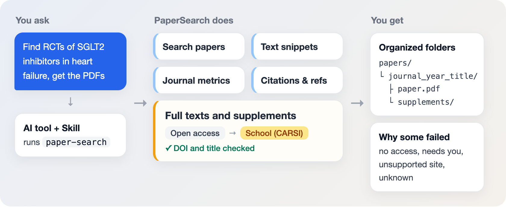
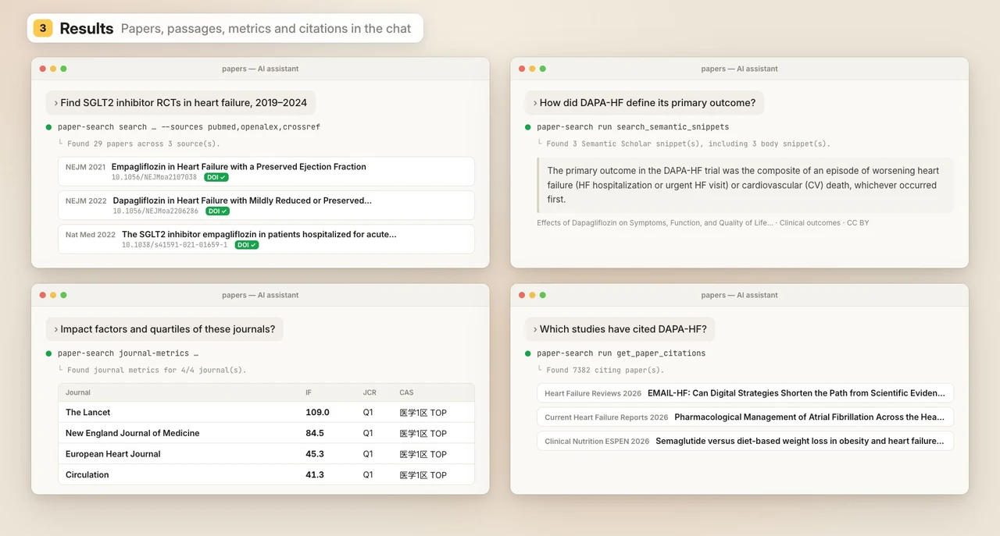
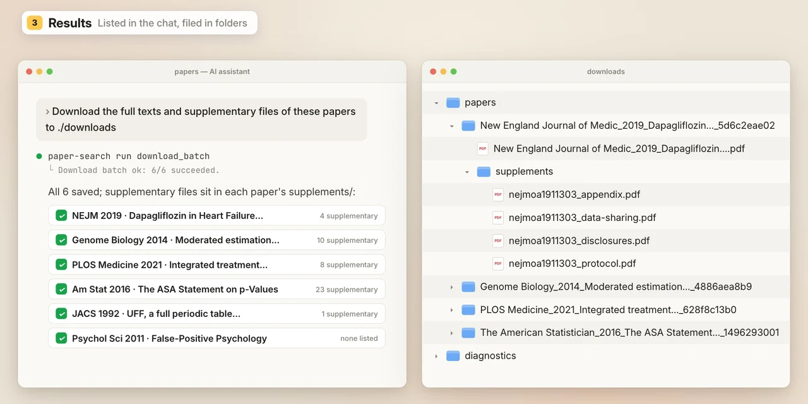

<p align="center">
  
</p>

<h1 align="center">PaperSearch</h1>

<p align="center"><b>A lightweight, fully automated all-in-one literature tool for AI</b><br>
One sentence and your AI searches, verifies and downloads full texts and supplementary files, all in the background.</p>

<p align="center"><a href="README.md">简体中文</a> | English</p>

<p align="center">
  <a href="https://www.npmjs.com/package/papersearch"></a>
  <a href="https://github.com/dr-dumpling/PaperSearch/actions/workflows/publish.yml"></a>
  <a href="https://nodejs.org/"></a>
  <a href="#1-school-subscription-downloads-carsi"></a>
  <a href="docs/guide.en.md#agent-skill"></a>
  <a href="#quick-start"></a>
  <a href="LICENSE"></a>
</p>

<p align="center">
  <a href="#demo-video">Demo video</a> · <a href="#quick-start">Quick start</a> · <a href="#1-school-subscription-downloads-carsi">School subscription downloads</a> · <a href="#2-api-keys">API keys</a> · <a href="docs/guide.en.md">Guide</a> · <a href="docs/ARCHITECTURE.zh.md">Architecture</a> · <a href="docs/ROADMAP.zh.md">Roadmap</a> · <a href="https://github.com/dr-dumpling/PaperSearch/issues/new/choose">Report an issue</a>
</p>

PaperSearch provides the `paper-search` command and a bundled Skill. Once installed, Claude Code, Codex, Cursor, Kimi Code, Qwen Code, CodeBuddy, TRAE and other AI tools that can run local commands can do this for you:

- **Search papers**: query more than 20 sources at once, including PubMed, Crossref, OpenAlex, Semantic Scholar and arXiv, with duplicates merged by DOI and DOIs verified.
- **Search full-text snippets**: search the paper bodies Semantic Scholar indexes for passages on methods or results, with their sources.
- **Look up journal IF and quartiles**: through EasyScholar, look up JCR impact factors, JCR quartiles and CAS zones.
- **Look up citations and references**: from one paper, find the studies that cite it and the works it cites.
- **Download full texts and supplementary files**:
  - Open-access papers: downloaded directly.
  - Subscription papers: through "[school subscription downloads (CARSI)](#1-school-subscription-downloads-carsi)" (recommended) or [API keys](#2-api-keys).

<p align="center"></p>

## Demo video


https://github.com/user-attachments/assets/9d54521b-bdb9-451c-89d8-889ec203bec1


## Quick start

### 1. Install in the chat

Send your AI tool this sentence (Node.js 18 or later is needed):

```text
Please install PaperSearch: npm install -g papersearch, then run paper-search skills update to give yourself its Skill.
```

It installs the command and the Skill, checks them, and tells you what already works.

Then **start a new chat** (most AI tools only read a newly installed Skill in a new chat) and send it:

```text
Start setup
```

<p align="center"></p>

### 2. Add school subscription downloads during setup

After "Start setup", your AI first asks whether to add [school subscription downloads (CARSI)](#1-school-subscription-downloads-carsi): full texts and supplementary files of subscription papers through your school account; it needs Chrome (installed too if missing) and downloads about 0.5 GB. It installs only after you agree, then asks for your school (or pick it at your first download) and opens the settings window.

- Don't want it? Say so and it is skipped for good; searching and open-access downloads work as before.
- Servers without a screen are not asked.

<p align="center"></p>

### 3. Add API keys when you need them

Say "start setup" in the new chat and your AI tells you which keys are missing and sets the download folder. Get a key when you need that feature (sign-up pages: [API keys](#2-api-keys)) and enter it any of these ways:

- **Settings window** (comes with school subscription downloads): ask your AI to open the settings, or click the gear on the capsule. API keys, the download folder, waiting times and notifications are all there, and every key has a Test button.
- **Send it to your AI**: paste the key into the chat; it saves and tests it. The key stays in that conversation's history; if you'd rather not, use the settings window or the terminal.
- **Terminal**: run `paper-search setup <KEY>`; the input is hidden.

### 4. Tell your AI tool what you need

Once set up, just say what you need, for example:

| To do | You can say |
|---|---|
| Search papers | Find randomized trials of SGLT2 inhibitors in heart failure since 2020, and verify the DOIs |
| Search full-text snippets | How did these trials define their primary endpoint? Quote a few passages |
| Look up journal IF and quartiles | Which journals were they published in, and what are their impact factors and quartiles? |
| Look up citations and references | Which studies have cited the DAPA-HF trial since it was published? |
| Download full texts and supplementary files | Download the full texts and supplementary files of these papers to ./downloads |

**Results:**

<p align="center"></p>

<p align="center"></p>

- Search results, snippets, journal metrics and citations come back in the conversation.
- Downloaded papers are organized into folders, one per paper, with supplementary files in supplements/; you are told why any paper was not obtained.

## Optional setup

Feature comparison:

| | Works once installed | API keys | School subscription downloads (CARSI) |
|---|:---:|:---:|:---:|
| **Search** | | | |
| &emsp;Search papers, citations and references | ✅ | — | — |
| &emsp;More search sources and limits | — | ✅ | — |
| **Journals and full text** | | | |
| &emsp;Impact factors and quartiles | — | ✅ | — |
| &emsp;Full-text snippets | — | ✅ | — |
| **Download** | | | |
| &emsp;Open-access papers | ✅ | — | — |
| &emsp;Subscription papers | — | ✅ (Elsevier, Springer) | ✅ (30+ major publishers) |
| &emsp;Supplementary files | — | — | ✅ |
| **You need** | Node.js 18 or later | Keys from each provider | Google Chrome, a school account |
| **How to turn it on** | Quick start step 1 | Settings window, your AI or terminal | Agree during setup |

### 1. School subscription downloads (CARSI)

Papers the open channels cannot get can come through your school's subscriptions. CARSI is the China higher-education identity federation; almost every Chinese university has joined it, so your school account signs you in to the publishers.

- **Your school account is enough**: no keys to apply for; publisher API keys only cover Elsevier and Springer.
- **Deep publisher adaptation**: the general download flow is deeply optimized, and more than 30 publishers have dedicated rules, one by one: where the institutional login is and how to fetch the PDF and supplementary files follow each publisher as it really is, so downloads are more accurate and fewer papers are missed. The main publishers:
  - General: Elsevier (including Cell and The Lancet), Springer Nature (including Nature and BMC), Wiley, Oxford Academic, Taylor & Francis, Sage, PNAS, Science
  - Medicine: NEJM, JAMA, AHA, ASH, Wolters Kluwer, Karger, Thieme
  - Science and engineering: ACS, IEEE, ACM
  - Full list: [publisher support table](skills/paper-search/references/publisher-support.md) (Chinese)
  - Need another publisher? [Open an issue](https://github.com/dr-dumpling/PaperSearch/issues/new/choose) with the DOI of an article you can access; these rules are maintained and extended over time.
- **Verification boxes clicked for you**: it finds and clicks human-verification boxes and carries on once the site lets it through; you are asked only when it does not pass.
- **Quiet background downloads**: the browser works in the background. The progress capsule in a screen corner shows the progress; it turns amber when you need to sign in or verify, one click switches to the browser, and the download carries on once you are done.

Install:

```bash
paper-search carsi install                # choose your school during installation
paper-search carsi status --format text   # check that it is ready
```

**Progress capsule**

<p align="center"></p>

**Verification pages**

<p align="center"></p>

**School sign-in**

<p align="center"></p>

**Asks when needed**

<p align="center"></p>

**Results**

<p align="center"></p>

### 2. API keys

Keys fall into four groups by what they are for. Get the key you need and enter it any of the ways in [Quick start step 3](#3-add-api-keys-when-you-need-them).

#### Journal metrics and full-text snippets

| Feature | Key | Where to get it |
|---|---|---|
| Look up impact factors and quartiles | `EASYSCHOLAR_KEY` | [EasyScholar](https://www.easyscholar.cc/) |
| Search full-text snippets | `SEMANTIC_SCHOLAR_API_KEY` | [Semantic Scholar](https://www.semanticscholar.org/product/api) |

#### Subscribed full texts through publisher APIs

| Publisher | Key | Where to get it |
|---|---|---|
| Elsevier | `ELSEVIER_API_KEY`; off campus, subscription articles also need `ELSEVIER_INSTTOKEN` | [Elsevier](https://dev.elsevier.com/apikey/manage) |
| Springer | `SPRINGER_API_KEY` | [Springer Nature](https://dev.springernature.com/) |

#### More search sources

| Source | Key | Where to get it |
|---|---|---|
| Web of Science | `WOS_API_KEY` | [Clarivate](https://developer.clarivate.com/apis) |
| IEEE Xplore | `IEEE_API_KEY` | [IEEE](https://developer.ieee.org/docs/read/Searching_the_IEEE_Xplore_Metadata_API) |
| ScienceDirect, Scopus | `ELSEVIER_API_KEY` (the same key as above) | [Elsevier](https://dev.elsevier.com/apikey/manage) |
| Springer | `SPRINGER_API_KEY` (the same key as above) | [Springer Nature](https://dev.springernature.com/) |

#### Higher limits, steadier access

| Source | Key | Where to get it |
|---|---|---|
| PubMed | `PUBMED_API_KEY` | [NCBI](https://ncbiinsights.ncbi.nlm.nih.gov/2017/11/02/new-api-keys-for-the-e-utilities/) |
| CORE | `CORE_API_KEY` | [CORE](https://core.ac.uk/services/api) |
| OpenAIRE | `OPENAIRE_API_KEY` | [OpenAIRE](https://develop.openaire.eu/) |
| OpenAlex (all citing papers past 10,000) | `OPENALEX_API_KEY` | [OpenAlex](https://openalex.org/settings/api) |

Settings are saved in `~/.config/paper-search-cli/config.json`, readable only by you. The download folder, contact emails, proxy, automatic updates and other settings are in [Guide · Other settings](docs/guide.en.md#other-settings).

## More documentation

The [guide](docs/guide.en.md): [command examples](docs/guide.en.md#command-examples), [how it works](docs/guide.en.md#how-it-works), [search sources](docs/guide.en.md#search-sources), [Agent Skill](docs/guide.en.md#agent-skill), [all commands](docs/guide.en.md#all-commands), [troubleshooting](docs/guide.en.md#troubleshooting). `paper-search tools --pretty` lists every tool and its parameters in the terminal.

## Roadmap

Next on the list:

1. **A better progress capsule**: better-timed reminders, with no early prompt when the school login page lets you through by itself; less of the browser briefly jumping to the front on Windows when it starts or changes pages; a cleaner look.
2. **Parallel downloads**: papers from different publishers download at the same time, cutting the total time for dozens or hundreds of papers; each publisher's download limits still apply.
3. **A Markdown full-text package**: besides the PDF, the original XML/HTML, a Markdown reading copy and the figures, with figure numbers, captions and in-text references matched, ready to hand to an AI for reading and citing.
4. **More ways to reach your school's access**: beyond China's CARSI, the identity federations of other countries (such as InCommon in the US and the UK federation); WebVPN, EZProxy and similar where possible.
5. **Better paper search and full-text snippets**: learn from similar tools and improve how papers and passages are found.

The full plan is in the [roadmap](docs/ROADMAP.zh.md) (Chinese); how it works inside is in the [architecture](docs/ARCHITECTURE.zh.md) (Chinese). Feature ideas are welcome as [issues](https://github.com/dr-dumpling/PaperSearch/issues/new/choose) and pull requests; for failed downloads or publisher requests use the matching issue template, and to add publisher rules yourself see [carsi/CONTRIBUTING.md](carsi/CONTRIBUTING.md).

## Acknowledgements

- Thanks to the LinuxDo community, where the command-plus-Skill approach and workflow improvements came from discussion and open sharing.
- [openags/paper-search-mcp](https://github.com/openags/paper-search-mcp): the project draws on its ideas, reworked into a standalone command.
- [Dianel555/paper-search-mcp-nodejs](https://github.com/Dianel555/paper-search-mcp-nodejs) (MIT): the command started as an adaptation of its Node.js implementation.
- [Rimagination/scansci-pdf](https://github.com/Rimagination/scansci-pdf) (MIT): the institutional download backend (`carsi/`) draws on its architecture (CARSI and other federation sign-in, publisher site capture, session reuse, PDF capture).

## License

MIT
