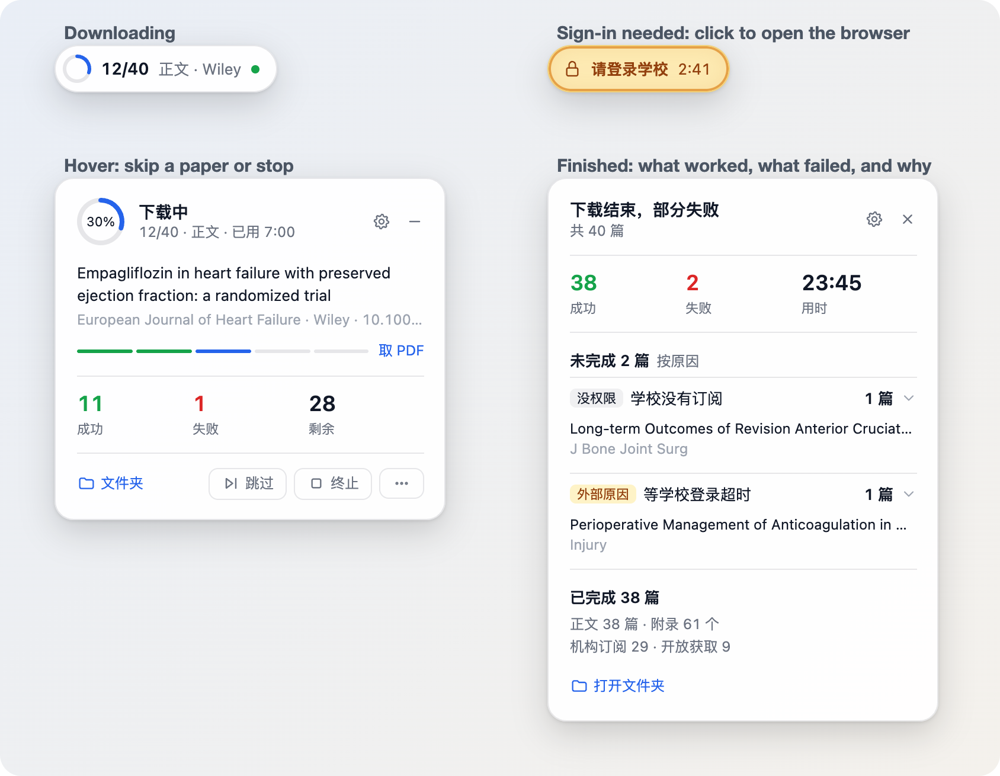

<p align="center">
  
</p>

<h1 align="center">PaperSearch</h1>

<p align="center"><b>Let your AI tools search the literature, verify citations, and download full texts and supplementary files.</b></p>

<p align="center">
  <a href="https://www.npmjs.com/package/papersearch"></a>
  <a href="https://github.com/dr-dumpling/PaperSearch/actions/workflows/publish.yml"></a>
  <a href="#institutional-download-extension"></a>
  <a href="https://nodejs.org/"></a>
  <a href="#agent-skill"></a>
  <a href="LICENSE"></a>
  <a href="https://linux.do"></a>
</p>

<p align="center"><a href="README.md">简体中文</a> | English</p>

PaperSearch provides the `paper-search` command and a bundled Skill. Once installed, Claude Code, Codex, Cursor, Kimi Code, Qwen Code, CodeBuddy, TRAE and other AI tools that can run local commands can search more than 20 scholarly sources for you, verify DOIs, and download and organize paper PDFs and supplementary files. You can also use it directly in a terminal or a script; output is JSON by default.

- **Open access, downloaded directly**: PubMed Central, Unpaywall, publisher APIs and more, ready as soon as it is installed.
- **Your school's subscriptions too**: the optional institutional download extension signs in to your school through CARSI and fetches the papers and supplementary files your school can access, in batches. It handles verification automatically and resumes downloading when the site grants access.
- **Every paper checked**: each PDF's first page is checked against the DOI and title; a file of another article is not counted as a success.
- **Ready to use**: one folder per paper named journal_year_title, with the main text and supplementary files together; papers not downloaded come with a reason.

<p align="center"></p>

[What you get](#what-you-get) | [Quick start](#quick-start) | [Common tasks](#common-tasks) | [How it works](#how-it-works) | [Institutional download extension](#institutional-download-extension) | [Search sources](#search-sources) | [Configuration](#configuration) | [Agent Skill](#agent-skill) | [Commands](#commands) | [Troubleshooting](#troubleshooting)

## What you get

Ask your AI tool in one sentence, for example:

> Find randomized trials of SGLT2 inhibitors in heart failure since 2020, verify the DOIs, and download the full texts and supplementary files to ./downloads

The AI calls PaperSearch to search, verify and download, then tells you what it got, what it could not get, and why. This is the result of an actual download:

```text
downloads/
├── papers/
│   ├── Nutrients_2026_α-Ketoglutarate Alleviates the Pathogenesis…_0b6e0203de/
│   │   ├── Nutrients_2026_α-Ketoglutarate Alleviates the Pathogenesis….pdf
│   │   └── supplements/
│   │       └── nutrients-18-03600-s001.zip       supplementary files keep their names
│   └── arXiv_2017_Attention Is All You Need_a1a0262a54/
│       └── arXiv_2017_Attention Is All You Need.pdf    preprints are labelled
└── diagnostics/                                   run records, file manifests, screenshots
```

## Quick start

First-time installation requires Node.js 18 or later and npm. Copy one line to install `paper-search` and its Skill for Codex. For another AI tool, replace `codex` with its `--targets` value from [Agent Skill](#agent-skill).

**macOS, Linux, or Windows Command Prompt:**

```sh
npm install -g papersearch && paper-search skills update --targets codex
```

**Windows PowerShell:**

```powershell
npm.cmd install -g papersearch; if ($LASTEXITCODE -eq 0) { paper-search.cmd skills update --targets codex }
```

Start a new AI session after installing, and you can search for papers. For terminal use, installing `paper-search` alone is enough. Run `paper-search setup` when you need to configure API keys or email. For papers your school subscribes to, install the [institutional download extension](#institutional-download-extension). Run `paper-search doctor --format text` to check which features are available.

If you already have `paper-search`, install the Skill on its own; the `--targets` values are listed under [Agent Skill](#agent-skill) below:

```bash
paper-search skills update --targets claude
```

You can also send this to your AI tool and let it do the install:

```text
Please install PaperSearch for me: run npm install -g papersearch, then install the bundled Skill for yourself using the README's Agent Skill instructions, then run paper-search doctor --format text and tell me which features work and which keys are missing; then ask me which folder downloaded papers should go to by default and save it with paper-search config set DEFAULT_DOWNLOAD_PATH. I will enter API keys myself with paper-search setup in a terminal; do not ask me to paste them into the chat.
```

**Coming from the old package `paper-search-cli`**: run `npm uninstall -g paper-search-cli`, then `npm install -g papersearch`. Both provide the same `paper-search` command and cannot be installed together; your configuration, Skill, school login and download records stay.

**Later upgrades**: `npm install -g papersearch@latest`. When a new version is out, commands say so in the terminal; the first run after an upgrade updates the Skill you installed.

## Common tasks

```bash
# Search papers (a set of sources that needs no keys)
paper-search search "machine learning clinical prediction" --sources no-key --max-results 5 --pretty

# One source, for example PubMed
paper-search search "SGLT2 inhibitor heart failure" --platform pubmed --max-results 10 --pretty

# Verify a DOI
paper-search run get_paper_by_doi --arg doi="10.1038/nature12373" --pretty

# Citing papers; for references use get_paper_references
paper-search run get_paper_citations --arg doi="10.1038/nature12373" --arg limit=5 --pretty

# Journal impact factors and quartiles (EasyScholar key)
paper-search journal-metrics "Nature" "BMJ" --pretty

# Find Methods wording in body text (Semantic Scholar key)
paper-search run search_semantic_snippets --arg query="propensity score matching" --arg limit=3 --pretty

# Download one paper
paper-search download "<DOI>" --platform crossref

# Download main texts and supplementary files in a batch (omit content for main text only; "supplements" for supplementary files only)
paper-search run download_batch --json-args '{"items":[{"doi":"<DOI-1>"},{"doi":"<DOI-2>"}],"content":"both"}'

# Papers not downloaded, and why
paper-search failures --format text
```

## How it works

```text
A literature request
│
├─ Find papers, verify DOI/PMID → paper-search search (Crossref, PubMed, OpenAlex, ...)
│    └─ Entries confirmed, full text needed → go to "Download" below
├─ Citing papers, references → paper-search run get_paper_citations / get_paper_references
├─ Impact factor, quartiles → paper-search journal-metrics (EasyScholar key)
├─ Methods wording, parameters → paper-search run search_semantic_snippets (Semantic Scholar key)
│
└─ Download main text, supplementary files → paper-search download / run download_with_fallback / run download_batch
     One download command, tried in order:
     ├─ ① Open downloading (built in): the source's own download, PMC, Unpaywall, publisher APIs
     ├─ ② Sci-Hub fallback (on by default, can be turned off)
     ├─ ③ Institutional download (optional extension): a browser signs in to your school through CARSI and takes the PDF and supplementary files from the publisher's site
     ├─ ④ arXiv preprint: only when no published version was found, and labelled as a preprint
     ├─ Every file is checked against the DOI and title on its first page; once one passes it is saved and the rest are not tried
     └─ Nothing found → paper-search failures says why
```

### Two ways to download

|  | Open downloading (default) | Institutional download (optional extension) |
|---|---|---|
| Available | As soon as PaperSearch is installed | After `paper-search carsi install` |
| Gets | Open-access main text | Main text your school subscribes to; supplementary files from the publishers with rules for them |
| How | Direct downloads, usually seconds, no login: the source's own download, PDF links in the metadata, PubMed Central, Unpaywall, publisher APIs (your own Elsevier/Springer keys); last, the Sci-Hub fallback, on by default | Chrome signs in to your school through CARSI and takes the PDF from the publisher's site |
| What you do | Nothing | Sign in to your school in the browser; verification is handled automatically, with a prompt when manual action is needed |

Both use the same download command: open downloading first, and when it finds nothing, the institutional download if it is installed.

- For dozens to hundreds of papers, use one `download_batch`: open channels are tried for every paper first, then the institutional download for papers still without a main text. Afterwards `paper-search failures` sorts the papers not downloaded into four classes: no access (with the evidence, such as the page's own words), needs you (login, verification, waiting), site not supported yet, and cause unknown.
- For arXiv papers the published version is tried first; the preprint is downloaded only when none was found. The result says `version: "preprint"` and, when known, gives the published DOI.
- To leave out Sci-Hub, set `"useSciHub": false` in `download_with_fallback` / `download_batch`.
- Every PDF is checked against the DOI and title on its first page; a file that does not match is not counted as a success and is kept aside for review.

### Download results

A download folder has two parts. `papers/` holds the papers, one folder each, with the main text named journal_year_title and supplementary files under that paper's `supplements/` with their original names. `diagnostics/` holds run records, file manifests and screenshots, for tracking down problems. The short ID at the end of a folder name tells apart papers with the same title. A missing journal or year is written as unknown. The JSON a command returns gives each file's actual location.

## Institutional download extension

Papers the open channels cannot get can come through your school's subscriptions: PaperSearch opens Chrome, signs in to your school through CARSI (the China higher-education identity federation), and takes the main text and supplementary files from the publisher's site.

Install [Google Chrome](https://www.google.com/chrome/) first, then run:

```bash
paper-search carsi install                # choose your school during installation
paper-search carsi status --format text   # check that it is ready
```

Then ask your AI tool to download papers as usual:

- **The first time a login is needed**, sign in to your school in the browser that opens; the login is remembered.
- **Human verification** is clicked automatically; you are asked only when it does not pass.
- **The progress capsule** in a screen corner shows the progress. It turns amber when you need to sign in or verify; click it to switch to the browser. Hover over it to skip a paper or stop the task; the gear sets the waiting times, the default download folder and system notifications.
- **The browser works in the background** and does not jump to the front.
- **When the download ends**, the capsule lists what succeeded and what failed, with reasons; `paper-search failures --format text` gives the details.

<p align="center"></p>

Which publishers' main texts and supplementary files it can fetch is in the [publisher support table](skills/paper-search/references/publisher-support.md) (Chinese).

Update the extension with `paper-search carsi update`; remove it with `paper-search carsi uninstall`. On Windows, if PowerShell blocks `npm`, use `npm.cmd`.

## Search sources

| Kind | Sources | API key |
|---|---|---|
| General academic metadata | Crossref, OpenAlex, Semantic Scholar, Google Scholar | None (Semantic Scholar body snippets need one) |
| Biomedicine | PubMed, PubMed Central, Europe PMC | None (a PubMed key raises the limits) |
| Preprints and conference papers | arXiv, bioRxiv, medRxiv, OpenReview, IACR ePrint | None |
| Computer science and engineering | DBLP, ACM, USENIX | None |
| Open access and repositories | CORE, OpenAIRE, Unpaywall | Unpaywall takes an email; CORE and OpenAIRE optional |
| Publishers and citation databases | ScienceDirect, Scopus, Springer Nature, IEEE Xplore, Web of Science | Each needs its key (ScienceDirect and Scopus share the Elsevier key) |
| Journal metrics | EasyScholar | Needed |

- The sources that need no key already cover the major publishers' papers; a key adds the publisher's own search.
- One source with `--platform`, several with `--sources a,b,c`; `--sources no-key` needs no keys at all (Crossref, PubMed, Europe PMC, arXiv, OpenReview).
- Google Scholar is read from its web pages and often meets human checks, so it is not in `--sources all`; use `--platform googlescholar` when you need it.
- The same paper from several sources is merged by DOI; when an arXiv preprint is explicitly linked to its published DOI, the published record is kept.
- Sci-Hub is not a search source; it only serves as a DOI fallback when downloading.

## Configuration

PaperSearch has two separate kinds of configuration, and both are optional:

|  | API keys | CARSI (institutional download extension) |
|---|---|---|
| What it is for | Search in some sources, journal metrics, body snippet search; Elsevier and Springer keys also fetch full text through the publisher API | Signing in to your school and downloading full texts and supplementary files through its subscriptions |
| How to set it up | `paper-search setup`, or `paper-search config set` | `paper-search carsi install`, choosing your school |
| Without it | Search uses the free sources; the sources and features that need a key under "Search sources" are unavailable | Downloads use the open channels only (see [Two ways to download](#two-ways-to-download)) |

### API keys and the configuration file

Most free sources need nothing. Run `paper-search setup` first to save keys in your user configuration:

```bash
paper-search setup
paper-search config list --pretty
paper-search config set SEMANTIC_SCHOLAR_API_KEY <your key>
```

The configuration file is `~/.config/paper-search-cli/config.json` (mode `0600`). `config list` and `doctor` show keys masked.

| Key | Use | When |
|---|---|---|
| `DEFAULT_DOWNLOAD_PATH` | Folder downloaded papers go to by default; unset, they go to `./downloads` under the command's current directory | At first setup; also in the progress capsule's settings |
| `SEMANTIC_SCHOLAR_API_KEY` | Body snippet search; steadier Semantic Scholar requests | For Methods details, or frequent Semantic Scholar use |
| `UNPAYWALL_EMAIL` | Open-access PDFs by DOI | Recommended; an email is enough |
| `CROSSREF_MAILTO` | Crossref's polite pool | Long or frequent searches |
| `CORE_API_KEY` | CORE repository search | Frequent CORE use, or rate limits |
| `EASYSCHOLAR_KEY` | Journal metrics | For impact factors and quartiles; `paper-search setup EASYSCHOLAR_KEY` hides the input |
| `PUBMED_API_KEY`, `NCBI_EMAIL` | Higher PubMed limits | Frequent PubMed use |
| `WOS_API_KEY`, `IEEE_API_KEY`, `ELSEVIER_API_KEY`, `SPRINGER_API_KEY` | Their metadata; Elsevier and Springer keys also serve the publisher API for full text (access follows your network or key) | When you use those sources |
| `ELSEVIER_INSTTOKEN` | Elsevier full text off campus through its API | Off campus; not needed on a campus network |
| `GOOGLE_SCHOLAR_PROXY_URL` | Egress proxy for Google Scholar | When direct requests keep being challenged; use a proxy you are allowed to use |
| `PAPER_SEARCH_CARSI_ENABLED` | Switch for the institutional download extension | Set by `paper-search carsi install` |
| `PAPER_SEARCH_SKILL_AUTO_UPDATE` | `false` stops upgrades from updating the installed Skill | On by default; set it to manage the Skill yourself |
| `PAPER_SEARCH_UPDATE_NOTIFY` | `false` stops the new-version notices | On by default; set it if you do not want the notices |

Where to get keys: [EasyScholar](https://www.easyscholar.cc/console/user/open) · [Semantic Scholar](https://www.semanticscholar.org/product/api) · [Unpaywall](https://unpaywall.org/products/api) · [CORE](https://core.ac.uk/services/api) · [NCBI](https://ncbiinsights.ncbi.nlm.nih.gov/2017/11/02/new-api-keys-for-the-e-utilities/) · [Web of Science](https://developer.clarivate.com/apis) · [IEEE Xplore](https://developer.ieee.org/docs/read/Searching_the_IEEE_Xplore_Metadata_API) · [Elsevier](https://dev.elsevier.com/apikey/manage) · [Springer Nature](https://dev.springernature.com/) · [OpenAIRE](https://develop.openaire.eu/)

### CARSI

Installing and using it: see [Institutional download extension](#institutional-download-extension). It uses no API key and does not search.

## Agent Skill

The Skill ships in the npm package (`skills/paper-search/`). It is written in Chinese, opens with the same overall diagram, and points the AI to focused references as needed: routing and the open download channels, the command contract, installing and using the institutional download, the [publisher support table](skills/paper-search/references/publisher-support.md), and troubleshooting. It only tells the AI how to call `paper-search`; it keeps no keys, cookies or accounts.

```bash
paper-search skills status --pretty
paper-search skills update --targets claude
```

`--targets` takes `codex`, `claude`, `cursor`, `gemini`, `antigravity` or `agents` (the shared `~/.agents/skills/` directory). For other AI tools that read Skill folders, copy the bundled Skill into their Skill directory: run `npm root -g` to locate the global npm directory; the bundled Skill is under `papersearch/skills/paper-search/` there. Copy the entire folder, including `references/`, and copy it again after an update. Start a new AI session after installation.

- `--targets all` syncs the Skill to all built-in locations. Updating overwrites the files the package manages and keeps files you added to the Skill directory.
- The first run after upgrading PaperSearch updates the Skill you installed; replaced files are backed up under `~/.local/share/paper-search-cli/skill-backups/`. To turn this off: `paper-search config set PAPER_SEARCH_SKILL_AUTO_UPDATE false`.
- `paper-search doctor` shows Skill locations and version status for the built-in installation targets.

## Commands

| Command | Use |
|---|---|
| `paper-search search` | Search paper metadata |
| `paper-search journal-metrics` | Journal metrics (EasyScholar) |
| `paper-search download` | Download the PDF of a verified paper |
| `paper-search run <tool>` | Call one tool exactly, with `--arg` or `--json-args` |
| `paper-search failures` | Why downloads failed, summarized |
| `paper-search update check` | Check for a new version |
| `paper-search carsi` | Install, check, update or remove the institutional download extension |
| `paper-search setup` / `config` | Configure keys, the Skill and the extension |
| `paper-search doctor` | Health check: configuration, available features, Skill and extension status |
| `paper-search skills` | Skill status, differences and updates |
| `paper-search smoke` | Offline or live self-check |
| `paper-search tools` | All tool names and their arguments |

Commands print JSON by default; `--pretty` formats it and `--format text` prints a report for people. All commands: `paper-search tools --pretty`, or the [command contract](skills/paper-search/references/cli-contract.md) (Chinese).

## Troubleshooting

| Problem | What to do |
|---|---|
| `paper-search` not found | Reinstall with `npm install -g papersearch` |
| `EEXIST` while installing | The old package is still there: `npm uninstall -g paper-search-cli` first |
| A feature does not work | `paper-search doctor --format text` shows what is missing; then `paper-search setup` |
| Subscribed articles do not download | `paper-search carsi status --format text` for the extension; `paper-search failures --format text` for each paper's reason |
| A source rate-limits | Lower `--max-results`, configure its key, or switch sources |
| Google Scholar shows a human check | Wait and retry, or use `--sources no-key` |
| The AI reads an old Skill | `paper-search skills status --pretty`, then `paper-search skills update --targets <tool>`; start a new AI session |

## Roadmap and contributing

- Next: steadier batch downloads and smoother installs on new computers; beyond PDFs, a full-text package (the original XML/HTML, Markdown and the figures). See the [roadmap](docs/ROADMAP.zh.md) (Chinese).
- How it works inside and where the code is: [architecture](docs/ARCHITECTURE.zh.md) (Chinese).
- For failed downloads or publisher requests, use the download-failure issue template and provide the version, OS, website and DOI. `paper-search failures --export ./failure-report.zip` exports the failure records; check the `summary.md` and screenshots in it for personal information before attaching it.
- To add publisher rules yourself: see [carsi/CONTRIBUTING.md](carsi/CONTRIBUTING.md).

## Use responsibly

Some sources are subject to platform terms, institutional subscriptions or local law; use them only where you have access. The institutional download uses your own school account and subscriptions; the source labels in results are for diagnosis and are not proof of entitlement.

## Origins

- Thanks to the [LinuxDo](https://linux.do) community, where the command-plus-Skill approach and workflow improvements came from discussion and open sharing.
- [openags/paper-search-mcp](https://github.com/openags/paper-search-mcp): the project draws on its ideas, reworked into a standalone command.
- [Rimagination/scansci-pdf](https://github.com/Rimagination/scansci-pdf) (MIT): the institutional download backend (`carsi/`) draws on its architecture (CARSI and other federation sign-in, publisher site capture, session reuse, PDF capture); its copyright notice is kept in `carsi/NOTICE`.

## License

MIT
