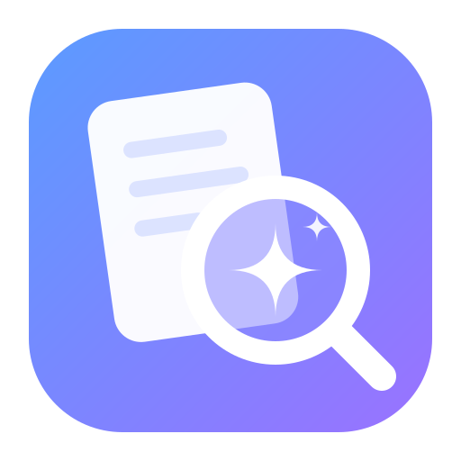
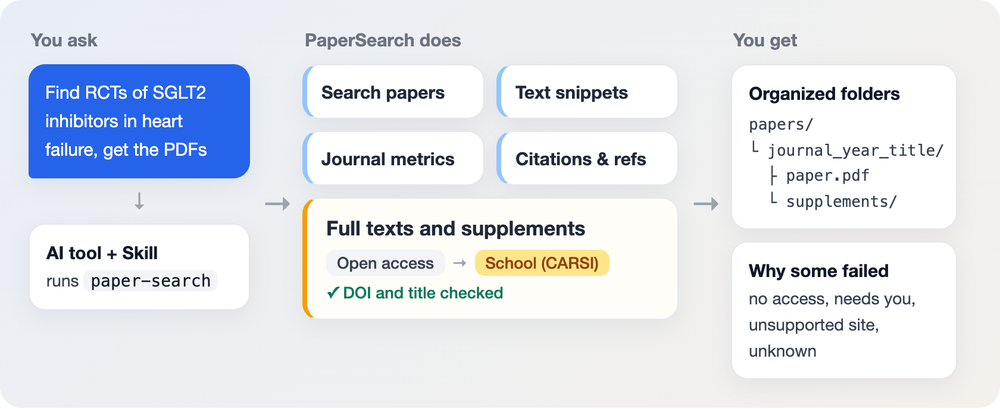
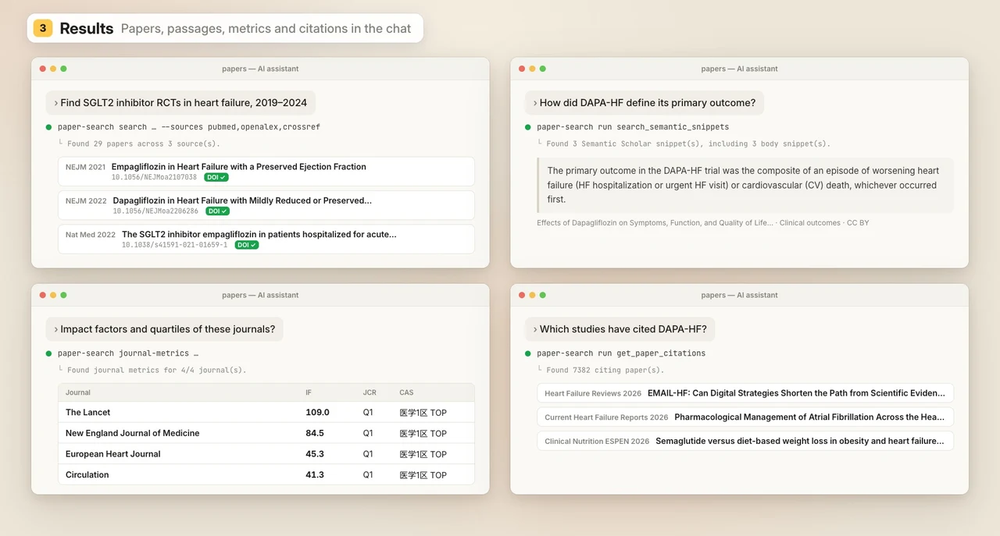
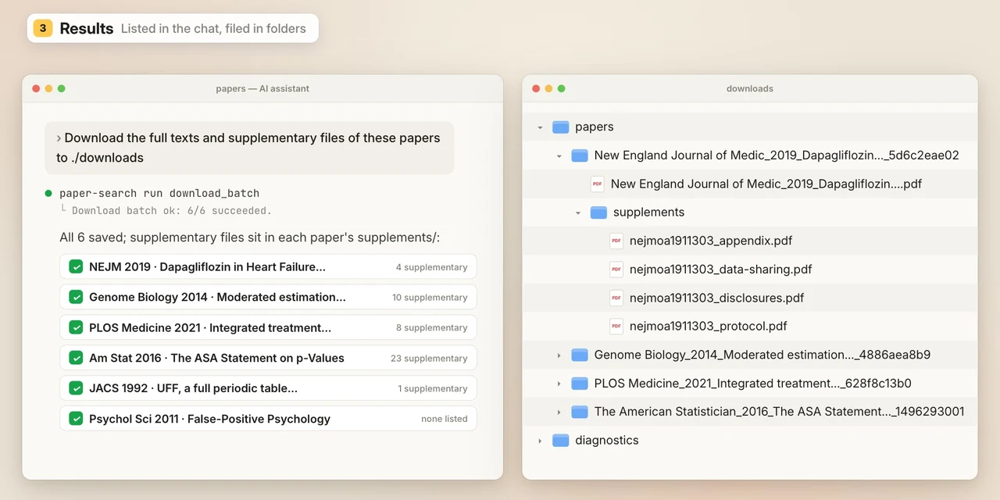
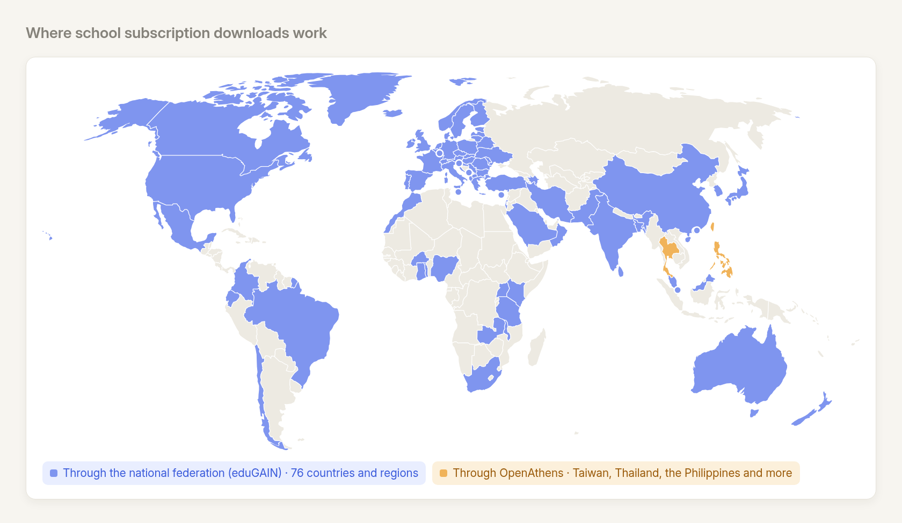

<p align="center">
  
</p>

<h1 align="center">PaperSearch</h1>

<p align="center"><b>L'outil bibliographique tout-en-un pour l'IA, léger et entièrement automatique</b><br>
Une phrase suffit : l'IA cherche et vérifie la littérature, télécharge les textes intégraux et les annexes, le tout en arrière-plan.</p>

<p align="center"><a href="README.md">简体中文</a> | <a href="README.zh-Hant.md">繁體中文</a> | <a href="README.en.md">English</a> | <a href="README.ja.md">日本語</a> | <a href="README.ko.md">한국어</a> | Français</p>

<p align="center">
  <a href="https://www.npmjs.com/package/papersearch"></a>
  <a href="https://github.com/dr-dumpling/PaperSearch/actions/workflows/publish.yml"></a>
  <a href="https://nodejs.org/"></a>
  <a href="#1-téléchargement-via-létablissement"></a>
  <a href="docs/guide.fr.md#agent-skill"></a>
  <a href="#démarrage-rapide"></a>
  <a href="LICENSE"></a>
  <a href="https://linux.do/"></a>
</p>

<p align="center">
  <a href="#vidéo-de-démonstration">Vidéo de démonstration</a> · <a href="#démarrage-rapide">Démarrage rapide</a> · <a href="#1-téléchargement-via-létablissement">Téléchargement via l'établissement</a> · <a href="#2-clés-api">Clés API</a> · <a href="docs/guide.fr.md">Guide d'utilisation</a> · <a href="docs/ARCHITECTURE.zh.md">Architecture</a> · <a href="docs/ROADMAP.zh.md">Feuille de route</a> · <a href="https://github.com/dr-dumpling/PaperSearch/issues/new/choose">Signaler un problème</a>
</p>

PaperSearch comprend la commande `paper-search` et un Skill inclus dans le paquet. Une fois PaperSearch installé, Claude Code, Codex, DeepSeek, GLM, Kimi Code, Qwen Code, CodeBuddy et les autres outils d'IA capables de lancer des commandes locales peuvent, à votre place :

- **Chercher des articles** : interroge en une fois plus de 20 sources, dont PubMed, Crossref, OpenAlex, Semantic Scholar et arXiv, fusionne les doublons par DOI et vérifie les DOI.
- **Rechercher des extraits de texte** : dans le texte des articles indexés par Semantic Scholar, cherche des phrases et retrouve le texte original des méthodes et des résultats, avec sa source.
- **Facteur d'impact et rang des revues** : via EasyScholar, trouve le facteur d'impact JCR, le quartile JCR et la zone de l'Académie chinoise des sciences (CAS).
- **Citations et références** : à partir d'un article, trouve les études qui le citent et les travaux qu'il cite.
- **Télécharger le texte intégral et les annexes** :
  - Articles en accès ouvert (OA) : téléchargés directement.
  - Articles non OA : configurez le « [téléchargement via l'établissement](#1-téléchargement-via-létablissement) » (recommandé) ou des [clés API](#2-clés-api).

<p align="center"></p>

## Vidéo de démonstration


https://github.com/user-attachments/assets/6c75c5de-9dd5-42e0-9dea-f44a1b4f3aac


## Démarrage rapide

### 1. Installation

Envoyez cette phrase à votre outil d'IA (Claude Code, Codex, DeepSeek, GLM, Kimi Code, Qwen Code, CodeBuddy, etc., tous conviennent) :

```text
Installe le Skill de PaperSearch : npx skills add dr-dumpling/PaperSearch -g -y
```

Sous Windows, cette commande demande Git ; s'il manque, installez d'abord [Git for Windows](https://git-scm.com/download/win).

Une fois le Skill installé, mentionnez-le et envoyez :

```text
/paper-search Lance la configuration
```

L'IA vous demande d'abord si elle doit installer le programme en ligne de commande de PaperSearch ; avec votre accord, elle l'installe, puis vous guide dans la configuration du téléchargement via l'établissement et des clés API.

<p align="center"></p>

### 2. Ajouter le téléchargement via l'établissement pendant la configuration

Après « Lance la configuration », l'IA vous demande d'abord si elle doit installer le [téléchargement via l'établissement](#1-téléchargement-via-létablissement) : il télécharge le texte intégral et les annexes des articles non OA avec votre compte d'établissement, et demande Chrome (installé en même temps s'il manque). Elle ne l'installe qu'avec votre accord, puis demande votre établissement, le configure et ouvre la fenêtre Réglages.

<p align="center"></p>

### 3. Ajouter des clés API selon vos besoins

Après « Lance la configuration », l'IA vous demande d'abord si vous voulez utiliser le téléchargement via l'établissement, puis avance pas à pas selon votre choix :

- **Avec le téléchargement via l'établissement** : clés API, dossier de téléchargement, temps d'attente et alertes se règlent dans la fenêtre Réglages, et chaque clé a son bouton « Tester ». Pour les modifier ensuite, demandez à l'IA d'ouvrir les réglages, ou cliquez sur la roue dentée de la capsule.
- **Sans** : l'IA liste les clés manquantes et où les obtenir (voir aussi [Clés API](#2-clés-api)) ; vous les saisissez en lançant `paper-search setup` dans un terminal, la saisie restant masquée ; ensuite, l'IA vérifie une à une qu'elles fonctionnent.

### 4. Utilisation

Une fois la configuration faite, mentionnez le Skill de PaperSearch et dites ce que vous cherchez, par exemple :

| Ce que vous voulez faire | Ce que vous pouvez dire |
|---|---|
| Chercher des articles | `/paper-search` Trouve les essais randomisés sur les inhibiteurs de SGLT2 dans l'insuffisance cardiaque depuis 2020 et vérifie les DOI |
| Rechercher des extraits de texte | `/paper-search` Comment ces essais définissent-ils leur critère principal dans le texte original ? Cite quelques passages |
| Facteur d'impact et rang des revues | `/paper-search` Dans quelles revues sont-ils publiés ? Quels sont leur facteur d'impact et leur rang ? |
| Citations et références | `/paper-search` Quelles études ont cité l'essai DAPA-HF depuis sa publication ? |
| Télécharger le texte intégral et les annexes | `/paper-search` Télécharge le texte intégral et les annexes de ces articles dans le dossier indiqué |

**Résultats :**

<p align="center"></p>

<p align="center"></p>

- Résultats de recherche, extraits de texte, indicateurs de revues et citations sont listés directement dans la conversation.
- Chaque téléchargement crée un dossier `AAAAMMJJ-HHmmss_PaperSearchDownload` dans le dossier de téléchargement : les PDF sont placés directement dedans ; un article dont on a récupéré les annexes a son propre dossier, qui contient le PDF avec ses annexes (supplements/) ; pour chaque article, le PDF et les annexes sont récupérés ensemble, pendant son téléchargement ; pour les articles non obtenus, la raison vous est donnée.

## Configuration facultative

Comparaison des fonctions :

| | Prêt dès l'installation | Clés API | Téléchargement via l'établissement |
|---|:---:|:---:|:---:|
| **Recherche** | | | |
| &emsp;Chercher des articles, citations et références | ✅ | — | — |
| &emsp;Plus de sources, limites plus hautes | — | ✅ | — |
| **Revues et texte intégral** | | | |
| &emsp;Facteur d'impact et rang | — | ✅ | — |
| &emsp;Rechercher des extraits de texte | — | ✅ | — |
| **Téléchargement** | | | |
| &emsp;Télécharger les articles OA | ✅ | — | — |
| &emsp;Télécharger les articles non OA | — | ✅ (Elsevier, Springer) | ✅ (30+ grands éditeurs) |
| &emsp;Télécharger les annexes | — | — | ✅ |

### 1. Téléchargement via l'établissement

Les articles introuvables par les voies ouvertes peuvent passer par les abonnements de votre établissement : le programme se connecte aux éditeurs via la fédération d'identité académique dont fait partie votre établissement, avec votre compte d'établissement. À la configuration, il suffit de donner le nom de votre établissement pour vous connecter et télécharger les articles non OA.

1. Via les fédérations interconnectées par [eduGAIN](https://edugain.org/), comme CARSI en Chine, HKAF à Hong Kong, SGAF à Singapour, etc. ;
2. Les établissements qui n'ont pas rejoint leur fédération nationale mais disposent d'un accès [OpenAthens](https://www.openathens.net/) peuvent aussi se connecter par ce biais.

**Fédérations d'identité académiques prises en charge**

<p align="center"></p>

<details>
<summary>Voir les fédérations par pays (par continent et région)</summary>

| Continent | Région | Pris en charge (lieu : fédération) |
|---|---|---|
| Asie | Asie de l'Est | Chine continentale, Macao : CARSI ; instituts de recherche de Chine continentale : CSTCloud ; Hong Kong : HKAF ; Japon : GakuNin ; Corée du Sud : KAFE ; Taïwan : via OpenAthens |
| Asie | Asie du Sud-Est | Singapour : SGAF ; Malaisie : SIFULAN ; Thaïlande, Philippines, etc. : via OpenAthens |
| Asie | Asie du Sud | Inde : INFED ; Sri Lanka : LIAF ; Bangladesh : TIGERfed ; Pakistan : PKIFED |
| Asie | Asie de l'Ouest | Turquie : YETKİM ; Arabie saoudite : Maeen ; Chypre : CyNet ; Israël : IUCC ; Iran : IRFED ; Azerbaïdjan : AzScienceNet ; Oman : OMREN |
| Europe | Europe de l'Ouest | Royaume-Uni : UK federation ; Irlande : Edugate ; France : RENATER ; Pays-Bas : SURFconext ; Belgique : Belnet ; Luxembourg : eduID Luxembourg |
| Europe | Europe du Nord | Danemark (avec l'Islande et le Groenland) : WAYF ; Suède : SWAMID ; Finlande : Haka ; Norvège : Feide |
| Europe | Europe centrale | Allemagne : DFN-AAI ; Suisse : Switch edu-ID ; Autriche : ACOnet ; Pologne : PIONIER.Id ; Tchéquie : eduID.cz ; Slovaquie : safeID ; Hongrie : eduId.hu |
| Europe | Europe du Sud | Espagne : SIR ; Portugal : RCTSaai ; Italie : IDEM ; Grèce : GRNET ; Malte : RiċerkaNET ; Slovénie : ArnesAAI ; Croatie : AAI@EduHr ; Serbie : iAMRES ; Monténégro : IDeduME ; Macédoine du Nord : AAIEduMk ; Albanie : RASH ; Bulgarie : BIF ; Roumanie : RoEduNetID |
| Europe | Europe de l'Est | Estonie : TAAT ; Lettonie : LAIFE ; Lituanie : LITNET FEDI ; Biélorussie : FEBAS ; Ukraine : PEANO ; Moldavie : LEAF |
| Amériques | Amérique du Nord | États-Unis : InCommon ; Canada : CAF |
| Amériques | Amérique centrale | Mexique : FENIX |
| Amériques | Amérique du Sud | Brésil : CAFe ; Chili : COFRe ; Colombie : COLFIRE ; Équateur : MINGA |
| Océanie | Australie et Nouvelle-Zélande | Australie : AAF ; Nouvelle-Zélande : Tuakiri |
| Afrique | Afrique de l'Est | Ouganda : RIF ; Kenya : RAFIKI ; Tanzanie : TERNET IF ; Malawi : MAREN ; Zambie : FIDERN |
| Afrique | Afrique de l'Ouest | Nigeria : NgRENID ; Ghana : GARNET ; Burkina Faso : eduID.bf ; Togo : eduID.tg |
| Afrique | Afrique du Nord et australe | Maroc : eduIDM ; Afrique du Sud : SAFIRE |

</details>

- Nom complet, nombre d'établissements et établissements testés de chaque fédération : voir le [tableau des fédérations](skills/paper-search/references/federation-support.md).
- Si votre établissement n'arrive pas à se connecter, ou pour faire prendre en charge le vôtre, [ouvrez un ticket](https://github.com/dr-dumpling/PaperSearch/issues/new?template=school-login.yml) avec le modèle « School sign-in problem », en indiquant le nom de l'établissement, le domaine de son site officiel, ainsi que l'éditeur et le DOI de l'article en cause.

- **Votre compte d'établissement suffit** : pas de clé à demander ; les clés API d'éditeurs ne couvrent qu'Elsevier et Springer.
- **Éditeurs adaptés en profondeur** : le processus général de téléchargement est optimisé en profondeur, et plus de 30 éditeurs ont chacun leurs règles dédiées : l'emplacement de la connexion établissement et la façon de récupérer le PDF et les annexes suivent le fonctionnement réel de chaque éditeur, pour des téléchargements plus précis et moins d'articles manqués. Principaux éditeurs optimisés :
  - Généralistes : Elsevier (dont Cell, Lancet), Springer Nature (dont Nature, BMC), Wiley, Oxford Academic, Taylor & Francis, Sage, PNAS, Science
  - Médecine : NEJM, JAMA, AHA, ASH, Wolters Kluwer, Karger, Thieme
  - Sciences et ingénierie : ACS, IEEE, ACM
  - Liste complète : [tableau des éditeurs](skills/paper-search/references/publisher-support.md)
  - Besoin d'un autre éditeur ? [Ouvrez un ticket](https://github.com/dr-dumpling/PaperSearch/issues/new/choose) avec le DOI d'un article auquel vous avez accès ; les règles d'adaptation sont maintenues et mises à jour en continu.
- **Clic automatique sur les cases de vérification** : face à une vérification anti-robot, le programme trouve la case et clique dessus, puis reprend le téléchargement une fois que le site laisse passer ; il ne vous alerte que s'il n'y arrive pas.
- **Téléchargement discret en arrière-plan** : le navigateur travaille en arrière-plan. La capsule de progression, dans un coin de l'écran, affiche l'avancement ; quand vous devez vous connecter à votre établissement ou faire une vérification à la main, elle passe à l'ambre : un clic affiche le navigateur, et le téléchargement reprend une fois que c'est fait.

Installation :

```bash
paper-search school install                # choisissez votre établissement pendant l'installation
paper-search school status --format text   # vérifier que c'est bien installé
```

**Capsule de progression**

<p align="center"></p>

**Vérifications passées automatiquement**

<p align="center"></p>

**Connexion automatique à l'établissement**

<p align="center"></p>

**Alerte quand on a besoin de vous**

<p align="center"></p>

**Bilan final**

<p align="center"></p>

### 2. Clés API

Elles se répartissent en quatre groupes selon leur usage : demandez les clés dont vous avez besoin (un e-mail se saisit directement, sans inscription), puis saisissez-les de l'une des façons décrites à l'[étape 3 du démarrage rapide](#3-ajouter-des-clés-api-selon-vos-besoins).

#### Recommandé

| Fonction | Clé à saisir | Où l'obtenir |
|---|---|---|
| Facteur d'impact et rang | `EASYSCHOLAR_KEY` | [EasyScholar](https://www.easyscholar.cc/) ([guide](https://docs.qq.com/aio/DTUxwZ3hUckVtZVJN), en chinois) |
| Rechercher des extraits de texte | `SEMANTIC_SCHOLAR_API_KEY` | [Semantic Scholar](https://www.semanticscholar.org/product/api) ([guide](https://docs.qq.com/aio/DTW9RdFVHc2hJUmpx), en chinois) |
| Trouver le texte gratuit lors du téléchargement | `PAPER_SEARCH_UNPAYWALL_EMAIL` | Sans inscription ([à propos d'Unpaywall](https://unpaywall.org/products/api)) |
| Chercher des articles, vérifier que les DOI existent | `CROSSREF_MAILTO` | Sans inscription ([à propos de Crossref](https://www.crossref.org/documentation/retrieve-metadata/rest-api/tips-for-using-the-crossref-rest-api/)) |

Dans la version de développement, ouvrez « Réglages → API key → YesCaptcha », saisissez votre ClientKey, puis utilisez « Tester » pour vérifier le solde avant d’enregistrer. Pour les défis d’images pris en charge, seules les images et la consigne sont envoyées ; les réponses sont saisies ou sélectionnées dans le navigateur local. Les pages de connexion universitaire sont exclues. [Créer un compte YesCaptcha](https://yescaptcha.com/).

Turnstile intégré peut passer au service si la vérification locale échoue, en envoyant uniquement l’origine publique du site et les paramètres du widget ; les vérifications Cloudflare pleine page restent locales.

#### Accès abonnés (facultatif)

| Éditeur | Clé à saisir | Où l'obtenir |
|---|---|---|
| Elsevier | `ELSEVIER_API_KEY` ; hors campus, les articles sur abonnement demandent aussi `ELSEVIER_INSTTOKEN` | [Elsevier](https://dev.elsevier.com/apikey/manage) |
| Springer | `SPRINGER_API_KEY` | [Springer Nature](https://dev.springernature.com/) |

#### Plus de sources (facultatif)

| Source | Clé à saisir | Où l'obtenir |
|---|---|---|
| Web of Science | `WOS_API_KEY` | [Clarivate](https://developer.clarivate.com/apis) |
| IEEE Xplore | `IEEE_API_KEY` | [IEEE](https://developer.ieee.org/docs/read/Searching_the_IEEE_Xplore_Metadata_API) |
| ScienceDirect, Scopus | `ELSEVIER_API_KEY` (la même que ci-dessus) | [Elsevier](https://dev.elsevier.com/apikey/manage) |
| Springer | `SPRINGER_API_KEY` (la même que ci-dessus) | [Springer Nature](https://dev.springernature.com/) |

#### Recherche accélérée (facultatif)

| Source | Clé à saisir | Où l'obtenir |
|---|---|---|
| PubMed | `PUBMED_API_KEY` | [NCBI](https://ncbiinsights.ncbi.nlm.nih.gov/2017/11/02/new-api-keys-for-the-e-utilities/) |
| OpenAlex (liste complète au-delà de 10 000 citations) | `OPENALEX_API_KEY` | [OpenAlex](https://openalex.org/settings/api) |
| CORE | `CORE_API_KEY` | [CORE](https://core.ac.uk/services/api) |
| OpenAIRE | `OPENAIRE_API_KEY` | [OpenAIRE](https://develop.openaire.eu/) |

La configuration est enregistrée dans `~/.config/paper-search-cli/config.json`, lisible par vous seul. Dossier de téléchargement, proxy, mises à jour automatiques et autres réglages : voir [Guide d'utilisation · Autres réglages](docs/guide.fr.md#autres-réglages).

## Plus de documentation

[Guide d'utilisation](docs/guide.fr.md) : [exemples de commandes](docs/guide.fr.md#exemples-de-commandes), [fonctionnement](docs/guide.fr.md#fonctionnement), [sources de recherche](docs/guide.fr.md#sources-de-recherche), [Agent Skill](docs/guide.fr.md#agent-skill), [toutes les commandes](docs/guide.fr.md#toutes-les-commandes), [dépannage](docs/guide.fr.md#dépannage). Vous pouvez aussi lancer `paper-search tools --pretty` dans un terminal pour voir tous les outils et leurs paramètres.

[Journal des modifications](CHANGELOG.md) (en chinois) : chaque version y est classée en sept aspects (installation et configuration, recherche et vérification, accès libre, téléchargement via l'établissement, fenêtre de suivi, résultats du téléchargement, documentation).

## Feuille de route

Prochaines étapes prévues :

1. **Capsule de progression améliorée** : des alertes au bon moment, sans dérangement anticipé quand la page de connexion de l'établissement laisse passer d'elle-même ; moins de passages furtifs du navigateur au premier plan sous Windows au démarrage ou au changement de page ; un meilleur affichage.
2. **Téléchargement en parallèle** : téléchargement simultané entre éditeurs différents, plusieurs articles à la fois, pour réduire la durée totale de dizaines ou de centaines d'articles ; chaque éditeur garde sa limite de téléchargement.
3. **Recherche d'articles et d'extraits de texte encore améliorée** : s'inspirer des outils similaires pour améliorer encore la recherche d'articles et d'extraits de texte.

Le plan complet est dans la [feuille de route](docs/ROADMAP.zh.md) (en chinois), le principe et la structure du code dans la [présentation de l'architecture](docs/ARCHITECTURE.zh.md) (en chinois). Pour toute autre fonction souhaitée, [tickets](https://github.com/dr-dumpling/PaperSearch/issues/new/choose) et PR sont les bienvenus ; pour un échec de téléchargement ou un éditeur à ajouter, utilisez le modèle de ticket correspondant ; pour ajouter vous-même des règles d'éditeur, voir [school/CONTRIBUTING.md](school/CONTRIBUTING.md).

## Remerciements

- Merci à la [communauté LINUX DO](https://linux.do/) : l'approche commande + Skill et les améliorations du flux de travail viennent des échanges et du partage open source de la communauté.
- [openags/paper-search-mcp](https://github.com/openags/paper-search-mcp) : ce projet reprend ses idées, transformées en un outil en ligne de commande autonome.
- [Rimagination/scansci-pdf](https://github.com/Rimagination/scansci-pdf) (MIT) : le backend de téléchargement institutionnel (`school/`) s'inspire de son architecture (connexion par fédérations comme CARSI, récupération sur les sites d'éditeurs, réutilisation des sessions, capture des PDF).

## Licence

[AGPL-3.0](LICENSE), avec une licence commerciale également proposée.
