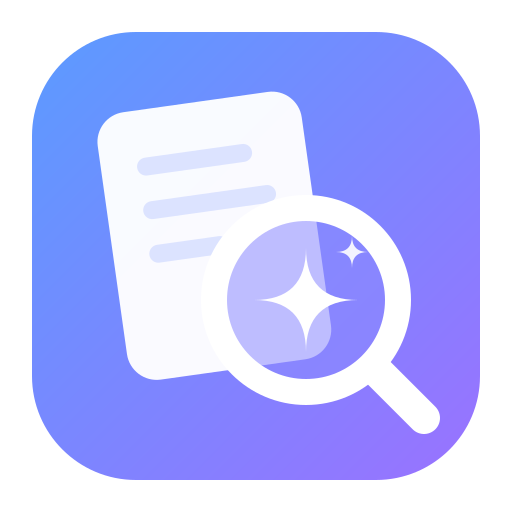
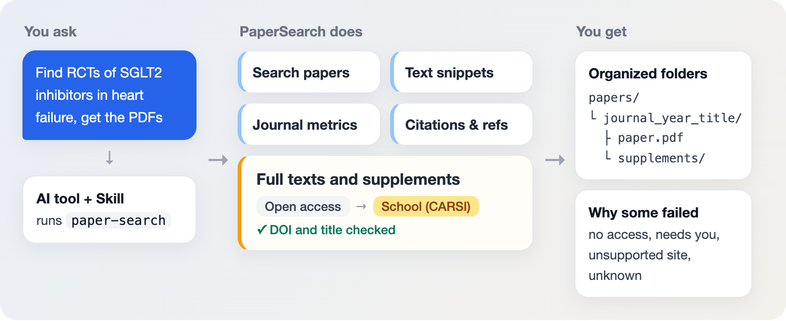
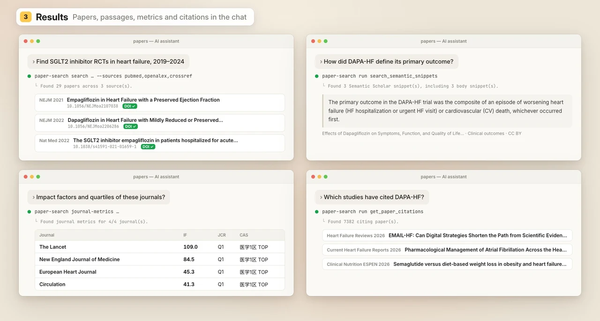
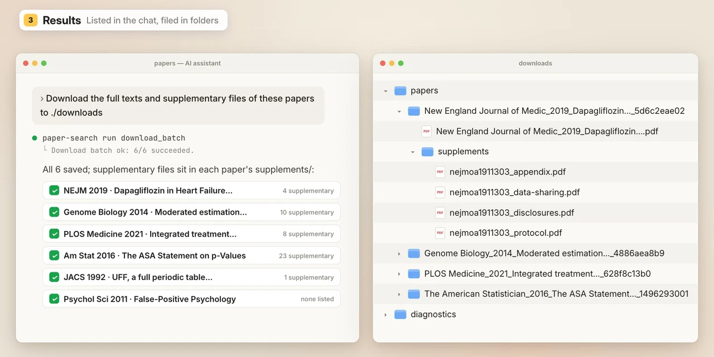
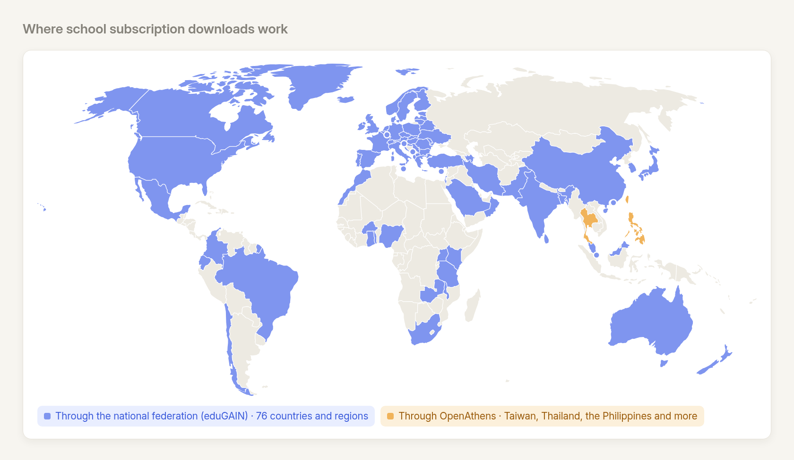

<p align="center">
  
</p>

<h1 align="center">PaperSearch</h1>

<p align="center"><b>軽量・全自動の AI 文献オールインワンツール</b><br>
ひと言伝えるだけで、文献の検索・確認から全文と補足資料のダウンロードまで、AI がバックグラウンドで自動で済ませます。</p>

<p align="center"><a href="README.md">简体中文</a> | <a href="README.zh-Hant.md">繁體中文</a> | <a href="README.en.md">English</a> | 日本語 | <a href="README.ko.md">한국어</a> | <a href="README.fr.md">Français</a></p>

<p align="center">
  <a href="https://www.npmjs.com/package/papersearch"></a>
  <a href="https://github.com/dr-dumpling/PaperSearch/actions/workflows/publish.yml"></a>
  <a href="https://nodejs.org/"></a>
  <a href="#1-学校購読ダウンロード"></a>
  <a href="docs/guide.ja.md#agent-skill"></a>
  <a href="#クイックスタート"></a>
  <a href="LICENSE"></a>
  <a href="https://linux.do/"></a>
</p>

<p align="center">
  <a href="#デモ動画">デモ動画</a> · <a href="#クイックスタート">クイックスタート</a> · <a href="#1-学校購読ダウンロード">学校購読ダウンロード</a> · <a href="#2-api-キー">API キー</a> · <a href="docs/guide.ja.md">使い方</a> · <a href="docs/ARCHITECTURE.zh.md">アーキテクチャ</a> · <a href="docs/ROADMAP.zh.md">ロードマップ</a> · <a href="https://github.com/dr-dumpling/PaperSearch/issues/new/choose">問題を報告</a>
</p>

PaperSearch は `paper-search` コマンドと同梱の Skill を提供します。インストールすると、Claude Code、Codex、DeepSeek、GLM、Kimi Code、Qwen Code、CodeBuddy など、ローカルのコマンドを実行できる AI ツールが次のことを代わりに行います：

- **論文を検索**：PubMed、Crossref、OpenAlex、Semantic Scholar、arXiv など 20 以上のデータソースを一度に検索し、重複を DOI でまとめ、DOI を確認します。
- **本文スニペットを検索**：Semantic Scholar が収録する論文本文から原文の文を探し、方法や結果の原文と出典を見つけます。
- **雑誌の IF と四分位を調べる**：EasyScholar で JCR インパクトファクター、JCR 四分位、中国科学院（CAS）分区を調べます。
- **被引用と参考文献を調べる**：1 本の論文から、それを引用している研究と、それが引用している文献をたどります。
- **全文と補足資料をダウンロード**：
  - OA 論文：そのままダウンロードします。
  - 非 OA 論文：「[学校購読ダウンロード](#1-学校購読ダウンロード)」（推奨）か [API キー](#2-api-キー) を設定して使います。

<p align="center"></p>

## デモ動画


https://github.com/user-attachments/assets/6c75c5de-9dd5-42e0-9dea-f44a1b4f3aac


## クイックスタート

### 1. インストール

お使いの AI ツール（Claude Code、Codex、DeepSeek、GLM、Kimi Code、Qwen Code、CodeBuddy など、どれでも構いません）に次の一文を送ります：

```text
PaperSearch の Skill をインストールしてください：npx skills add dr-dumpling/PaperSearch -g -y
```

Windows ではこのコマンドに Git が必要です。ない場合は先に [Git for Windows](https://git-scm.com/download/win) をインストールしてください。

インストールできたら Skill を呼び出して、次の一文を送ります：

```text
/paper-search 設定を開始してください
```

AI はまず PaperSearch のコマンドラインプログラムをインストールするか尋ね、同意するとインストールしてから、学校購読ダウンロードと API キーの設定を案内します。

<p align="center"></p>

### 2. 設定時に学校購読ダウンロードを追加

「設定を開始してください」と送ると、AI はまず[学校購読ダウンロード](#1-学校購読ダウンロード)をインストールするか尋ねます。学校のアカウントで非 OA 論文の全文と補足資料をダウンロードする機能で、Chrome が必要です（なければ一緒にインストールします）。同意した場合だけインストールし、終わると学校を尋ねて設定し、設定ウィンドウを開きます。

<p align="center"></p>

### 3. 必要に応じて API キーを入力

「設定を開始してください」と送ると、AI はまず学校購読ダウンロードを使うか尋ね、選んだ方法に沿って一つずつ進めます：

- **学校購読ダウンロードを使う場合**：API キー、ダウンロード先、待機時間、通知はすべて設定ウィンドウで入力し、キーごとに「テスト」を押して確認できます。あとで変えるときは、AI に設定を開いてもらうか、カプセルの歯車を押します。
- **使わない場合**：AI が足りないキーと取得先を示します（[API キー](#2-api-キー)も参照）。ターミナルで `paper-search setup` を実行して入力します（入力内容は表示されません）。入力後、AI がキーごとに使えるかテストします。

### 4. 使い始める

設定が済んだら、PaperSearch の Skill を呼び出して、調べたい内容を伝えます。たとえば：

| やりたいこと | 伝え方の例 |
|---|---|
| 論文を検索 | `/paper-search` 2020 年以降の、SGLT2 阻害薬による心不全治療のランダム化比較試験を探して、DOI を確認してください |
| 本文スニペットを検索 | `/paper-search` これらの試験の主要評価項目は、原文でどう定義されていますか？原文を何か所か抜き出してください |
| 雑誌の IF と四分位を調べる | `/paper-search` 掲載誌はどこですか？それぞれのインパクトファクターと四分位は？ |
| 被引用と参考文献を調べる | `/paper-search` DAPA-HF 試験の発表後、どんな研究がこれを引用していますか |
| 全文と補足資料をダウンロード | `/paper-search` これらの論文の全文と補足資料を、指定したフォルダにダウンロードしてください |

**結果：**

<p align="center"></p>

<p align="center"></p>

- 検索結果、本文スニペット、雑誌の指標、被引用は、会話の中にそのまま表示します。
- ダウンロードのたびに、ダウンロード先に `年月日-時分秒_PaperSearchDownload` フォルダを作ります。PDF はその中に直接置き、補足資料を取得できた論文は個別のフォルダに分けて、PDF、補足資料（supplements/）をまとめて入れます。各論文の PDF と補足資料は、その論文のダウンロード時にまとめて完了します。取得できなかった論文は理由をお知らせします。

## オプション設定

機能の比較：

| | インストールだけで使える |  API キー | 学校購読ダウンロード |
|---|:---:|:---:|:---:|
| **検索** | | | |
| &emsp;論文検索、被引用と参考文献 | ✅ | — | — |
| &emsp;検索ソースの追加、上限の引き上げ | — | ✅ | — |
| **雑誌と本文** | | | |
| &emsp;インパクトファクターと四分位 | — | ✅ | — |
| &emsp;本文スニペット検索 | — | ✅ | — |
| **ダウンロード** | | | |
| &emsp;OA 論文のダウンロード | ✅ | — | — |
| &emsp;非 OA 論文のダウンロード | — | ✅（Elsevier、Springer） | ✅（主要出版社 30 社以上） |
| &emsp;補足資料のダウンロード | — | — | ✅ |

### 1. 学校購読ダウンロード

オープンな入手先で取得できない論文は、学校の購読を利用してダウンロードできます。プログラムが学校の加盟する学術認証フェデレーション経由で出版社にログインし、学校のアカウントでダウンロードします。設定時に学校名を伝えるだけで、ログインして非 OA 論文をダウンロードできます。

1. [eduGAIN](https://edugain.org/) で相互接続されたフェデレーション経由（中国の CARSI、香港の HKAF、シンガポールの SGAF など）。
2. 自国のフェデレーションに加盟していない学校でも、[OpenAthens](https://www.openathens.net/) の利用権があれば、それを経由してログインできます。

**対応している学術認証フェデレーション**

<p align="center"></p>

<details>
<summary>国ごとのフェデレーションを表示（大陸・地域別）</summary>

| 大陸 | 地域 | 対応済み（地域：フェデレーション） |
|---|---|---|
| アジア | 東アジア | 中国本土・マカオ：CARSI、中国本土の研究機関：CSTCloud（中国科技雲連盟）、香港：HKAF、日本：GakuNin（学認）、韓国：KAFE、台湾：OpenAthens 経由 |
| アジア | 東南アジア | シンガポール：SGAF、マレーシア：SIFULAN、タイ・フィリピンなど：OpenAthens 経由 |
| アジア | 南アジア | インド：INFED、スリランカ：LIAF、バングラデシュ：TIGERfed、パキスタン：PKIFED |
| アジア | 西アジア | トルコ：YETKİM、サウジアラビア：Maeen、キプロス：CyNet、イスラエル：IUCC、イラン：IRFED、アゼルバイジャン：AzScienceNet、オマーン：OMREN |
| ヨーロッパ | 西ヨーロッパ | イギリス：UK federation、アイルランド：Edugate、フランス：RENATER、オランダ：SURFconext、ベルギー：Belnet、ルクセンブルク：eduID Luxembourg |
| ヨーロッパ | 北ヨーロッパ | デンマーク（アイスランド・グリーンランドを含む）：WAYF、スウェーデン：SWAMID、フィンランド：Haka、ノルウェー：Feide |
| ヨーロッパ | 中央ヨーロッパ | ドイツ：DFN-AAI、スイス：Switch edu-ID、オーストリア：ACOnet、ポーランド：PIONIER.Id、チェコ：eduID.cz、スロバキア：safeID、ハンガリー：eduId.hu |
| ヨーロッパ | 南ヨーロッパ | スペイン：SIR、ポルトガル：RCTSaai、イタリア：IDEM、ギリシャ：GRNET、マルタ：RiċerkaNET、スロベニア：ArnesAAI、クロアチア：AAI@EduHr、セルビア：iAMRES、モンテネグロ：IDeduME、北マケドニア：AAIEduMk、アルバニア：RASH、ブルガリア：BIF、ルーマニア：RoEduNetID |
| ヨーロッパ | 東ヨーロッパ | エストニア：TAAT、ラトビア：LAIFE、リトアニア：LITNET FEDI、ベラルーシ：FEBAS、ウクライナ：PEANO、モルドバ：LEAF |
| アメリカ大陸 | 北アメリカ | アメリカ：InCommon、カナダ：CAF |
| アメリカ大陸 | 中央アメリカ | メキシコ：FENIX |
| アメリカ大陸 | 南アメリカ | ブラジル：CAFe、チリ：COFRe、コロンビア：COLFIRE、エクアドル：MINGA |
| オセアニア | オーストラリアとニュージーランド | オーストラリア：AAF、ニュージーランド：Tuakiri |
| アフリカ | 東アフリカ | ウガンダ：RIF、ケニア：RAFIKI、タンザニア：TERNET IF、マラウイ：MAREN、ザンビア：FIDERN |
| アフリカ | 西アフリカ | ナイジェリア：NgRENID、ガーナ：GARNET、ブルキナファソ：eduID.bf、トーゴ：eduID.tg |
| アフリカ | 北アフリカ・南部アフリカ | モロッコ：eduIDM、南アフリカ：SAFIRE |

</details>

- 各フェデレーションの正式名称、学校数、実際にテストした学校は、[学術フェデレーション対応表](skills/paper-search/references/federation-support.md)を参照してください。
- 学校にログインできない場合や、自分の学校への対応を希望する場合は、「School sign-in problem or school request」テンプレートで [Issue を作成](https://github.com/dr-dumpling/PaperSearch/issues/new?template=school-login.yml)し、学校名、公式サイトのドメイン、問題が起きた出版社と論文の DOI を書いてください。

- **学校のアカウントだけで使える**：キーを別途取得する必要はありません。出版社の API キーが対応するのは Elsevier と Springer の 2 社だけです。
- **出版社ごとの細かな対応**：ダウンロードの共通の流れを徹底的に最適化したうえで、30 社以上の出版社ごとに専用のルールを用意しています。機関ログインの入口の場所や、PDF と補足資料の取得方法は各出版社の実際の仕様に合わせているため、より正確に、取りこぼし少なくダウンロードできます。主な対象出版社：
  - 総合：Elsevier（Cell、Lancet を含む）、Springer Nature（Nature、BMC を含む）、Wiley、Oxford Academic、Taylor & Francis、Sage、PNAS、Science
  - 医学：NEJM、JAMA、AHA、ASH、Wolters Kluwer、Karger、Thieme
  - 理工学：ACS、IEEE、ACM
  - 全リストは [出版社対応表](skills/paper-search/references/publisher-support.md)を参照
  - ほかの出版社への対応が必要な場合は、アクセス権のある論文の DOI を添えて [Issue を作成](https://github.com/dr-dumpling/PaperSearch/issues/new/choose)してください。対応ルールは継続して保守・更新しています。
- **確認ボックスを自動でクリック**：ボット確認が出ると、プログラムが自動で位置を特定してクリックし、サイトに通されるとダウンロードを続けます。通過できないときだけお知らせします。
- **バックグラウンドで邪魔をしない**：ブラウザはバックグラウンドで動作します。画面の隅の進捗カプセルに進捗が表示され、学校へのログインや手動の確認が必要になると琥珀色に変わります。クリックするとブラウザに切り替わり、対応が終わるとプログラムがダウンロードを再開します。

インストール：

```bash
paper-search school install                # インストール時に学校を選択
paper-search school status --format text   # インストールできたか確認
```

**進捗カプセル**

<p align="center"></p>

**自動で確認を通過**

<p align="center"></p>

**学校への自動ログイン**

<p align="center"></p>

**必要なときにお知らせ**

<p align="center"></p>

**終了時の一覧**

<p align="center"></p>

### 2. API キー

用途別に 4 つのグループに分かれています。必要なグループのキーを取得し（メールアドレスはそのまま入力するだけで、取得は不要です）、[クイックスタートの手順 3](#3-必要に応じて-api-キーを入力) のどちらかの方法で入力します。

#### 推奨設定

| 機能 | 入力するキー | 取得先 |
|---|---|---|
| インパクトファクターと四分位 | `EASYSCHOLAR_KEY` | [EasyScholar](https://www.easyscholar.cc/)（[取得ガイド](https://docs.qq.com/aio/DTUxwZ3hUckVtZVJN)、中国語） |
| 本文スニペット検索 | `SEMANTIC_SCHOLAR_API_KEY` | [Semantic Scholar](https://www.semanticscholar.org/product/api)（[取得ガイド](https://docs.qq.com/aio/DTW9RdFVHc2hJUmpx)、中国語） |
| ダウンロード時に無料の全文を探す | `PAPER_SEARCH_UNPAYWALL_EMAIL` | 取得不要（[Unpaywall の説明](https://unpaywall.org/products/api)） |
| 論文検索と DOI の実在確認 | `CROSSREF_MAILTO` | 取得不要（[Crossref の説明](https://www.crossref.org/documentation/retrieve-metadata/rest-api/tips-for-using-the-crossref-rest-api/)） |

開発版では「設定 → API key → YesCaptcha」に ClientKey を入力し、「テスト」で残高とキーを確認して保存します。対応する画像認証では問題の画像と質問だけを送信し、回答の入力やクリックはローカルブラウザーで行います。大学のログインページは送信しません。[YesCaptcha に登録](https://yescaptcha.com/)

埋め込み型Turnstileはローカル認証が完了しない場合にサービスへ引き継ぎ、公開サイトのオリジンとウィジェットのパラメーターだけを送信します。ページ全体のCloudflare認証はローカルで処理します。

#### 購読全文のダウンロード（任意）

| 出版社 | 入力するキー | 取得先 |
|---|---|---|
| Elsevier | `ELSEVIER_API_KEY`。学外から購読論文をダウンロードするには `ELSEVIER_INSTTOKEN` も必要 | [Elsevier](https://dev.elsevier.com/apikey/manage) |
| Springer | `SPRINGER_API_KEY` | [Springer Nature](https://dev.springernature.com/) |

#### 検索ソースを追加（任意）

| ソース | 入力するキー | 取得先 |
|---|---|---|
| Web of Science | `WOS_API_KEY` | [Clarivate](https://developer.clarivate.com/apis) |
| IEEE Xplore | `IEEE_API_KEY` | [IEEE](https://developer.ieee.org/docs/read/Searching_the_IEEE_Xplore_Metadata_API) |
| ScienceDirect、Scopus | `ELSEVIER_API_KEY`（上と同じキー） | [Elsevier](https://dev.elsevier.com/apikey/manage) |
| Springer | `SPRINGER_API_KEY`（上と同じキー） | [Springer Nature](https://dev.springernature.com/) |

#### 検索の高速化・安定化（任意）

| ソース | 入力するキー | 取得先 |
|---|---|---|
| PubMed | `PUBMED_API_KEY` | [NCBI](https://ncbiinsights.ncbi.nlm.nih.gov/2017/11/02/new-api-keys-for-the-e-utilities/) |
| OpenAlex（被引用が 1 万件を超えても全件表示） | `OPENALEX_API_KEY` | [OpenAlex](https://openalex.org/settings/api) |
| CORE | `CORE_API_KEY` | [CORE](https://core.ac.uk/services/api) |
| OpenAIRE | `OPENAIRE_API_KEY` | [OpenAIRE](https://develop.openaire.eu/) |

設定は `~/.config/paper-search-cli/config.json` に保存され、本人だけが読めます。ダウンロード先、プロキシ、自動更新などのその他の設定は [使い方 · その他の設定](docs/guide.ja.md#その他の設定) を参照してください。

## その他のドキュメント

[使い方](docs/guide.ja.md)：[コマンド例](docs/guide.ja.md#コマンド例)、[仕組み](docs/guide.ja.md#仕組み)、[検索ソース](docs/guide.ja.md#検索ソース)、[Agent Skill](docs/guide.ja.md#agent-skill)、[コマンド一覧](docs/guide.ja.md#コマンド一覧)、[トラブルシューティング](docs/guide.ja.md#トラブルシューティング)。ターミナルで `paper-search tools --pretty` を実行して、すべてのツールと引数を確認することもできます。

[更新履歴](CHANGELOG.md)（中国語）：各バージョンの変更を、インストールと設定、検索と確認、オープンダウンロード、学校購読ダウンロード、進捗ウィンドウ、ダウンロード結果、ドキュメントの 7 項目に分けて記載しています。

## ロードマップ

次に取り組む予定のこと：

1. **進捗カプセルの改善**：通知のタイミングをより正確にし、学校のログインページを自動で通過できるときは先に知らせないようにします。Windows でブラウザの起動時やページ切り替え時に一瞬前面に出ることを減らし、表示も改善します。
2. **並列ダウンロード**：異なる出版社の論文を並行してダウンロードし、複数の論文を同時に処理して、数十〜数百件の合計時間を短縮します。出版社ごとのダウンロード上限は引き続き守ります。
3. **論文検索と本文スニペット検索のさらなる改善**：同種のツールのやり方を参考に、論文検索と本文スニペット検索の精度をさらに高めます。

計画の全体は [ロードマップ](docs/ROADMAP.zh.md)（中国語）、仕組みとコード構成は [アーキテクチャ](docs/ARCHITECTURE.zh.md)（中国語）を参照してください。ほしい機能があれば [Issue](https://github.com/dr-dumpling/PaperSearch/issues/new/choose) や PR をお寄せください。ダウンロードの失敗や出版社への対応の要望は対応する Issue テンプレートを使ってください。出版社のルールを自分で追加する方法は [school/CONTRIBUTING.md](school/CONTRIBUTING.md) にあります。

## 謝辞

- [LINUX DO コミュニティ](https://linux.do/) に感謝します：コマンド + Skill という方針とワークフローの改善は、コミュニティでの交流とオープンな共有から生まれました。
- [openags/paper-search-mcp](https://github.com/openags/paper-search-mcp)：本プロジェクトはその考え方を参考にし、独立したコマンドラインツールに作り直しました。
- [Dianel555/paper-search-mcp-nodejs](https://github.com/Dianel555/paper-search-mcp-nodejs)（MIT）：コマンドライン版は当初、その Node.js 実装を改変して作りました。
- [Rimagination/scansci-pdf](https://github.com/Rimagination/scansci-pdf)（MIT）：機関ダウンロードのバックエンド（`school/`）は、そのアーキテクチャ（CARSI などのフェデレーションへのログイン、出版社サイトの取得、セッションの再利用、PDF の取得）を参考にしています。

## ライセンス

[AGPL-3.0](LICENSE)。商用ライセンスも提供しています。
