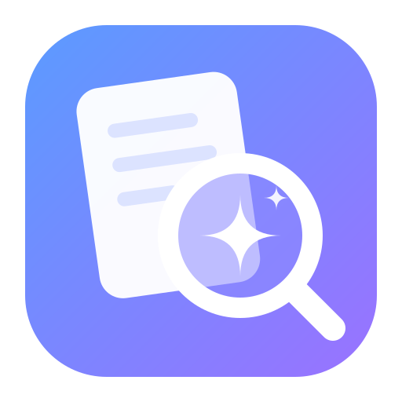
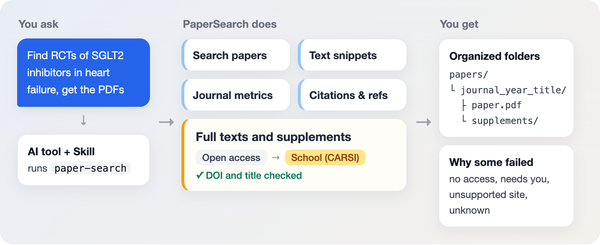
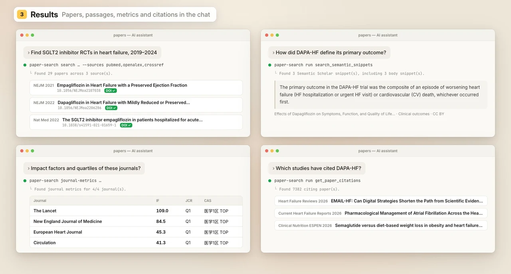
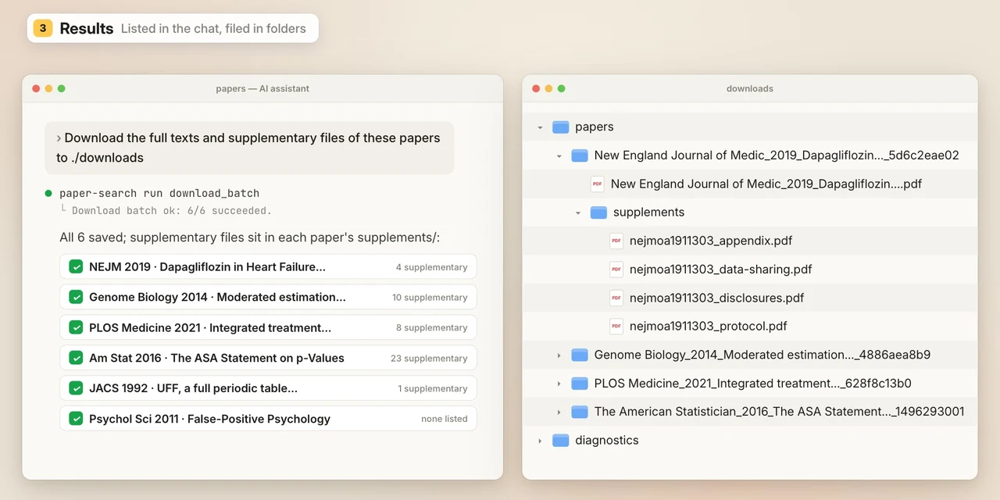
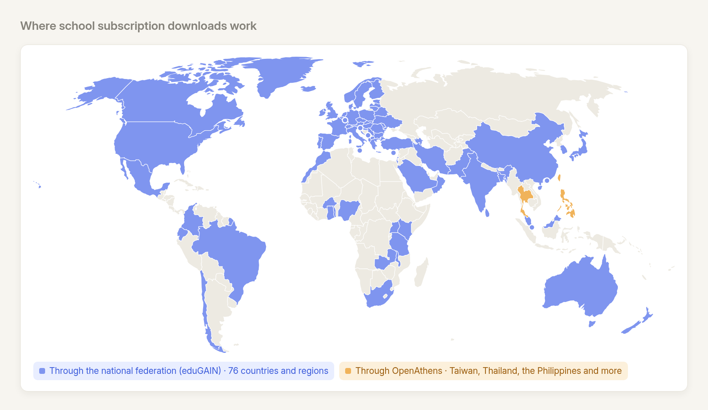

<p align="center">
  
</p>

<h1 align="center">PaperSearch</h1>

<p align="center"><b>가볍고 완전 자동인 AI 문헌 올인원 도구</b><br>
한 문장이면 AI가 문헌 검색, 확인, 전문과 보충 자료 다운로드를 백그라운드에서 자동으로 끝냅니다.</p>

<p align="center"><a href="README.md">简体中文</a> | <a href="README.zh-Hant.md">繁體中文</a> | <a href="README.en.md">English</a> | <a href="README.ja.md">日本語</a> | 한국어 | <a href="README.fr.md">Français</a></p>

<p align="center">
  <a href="https://www.npmjs.com/package/papersearch"></a>
  <a href="https://github.com/dr-dumpling/PaperSearch/actions/workflows/publish.yml"></a>
  <a href="https://nodejs.org/"></a>
  <a href="#1-학교-구독-다운로드"></a>
  <a href="docs/guide.ko.md#agent-skill"></a>
  <a href="#빠른-시작"></a>
  <a href="LICENSE"></a>
  <a href="https://linux.do/"></a>
</p>

<p align="center">
  <a href="#데모-영상">데모 영상</a> · <a href="#빠른-시작">빠른 시작</a> · <a href="#1-학교-구독-다운로드">학교 구독 다운로드</a> · <a href="#2-api-key">API key</a> · <a href="docs/guide.ko.md">사용 안내</a> · <a href="docs/ARCHITECTURE.zh.md">아키텍처 설명</a> · <a href="docs/ROADMAP.zh.md">로드맵</a> · <a href="https://github.com/dr-dumpling/PaperSearch/issues/new/choose">문제 보고</a>
</p>

PaperSearch는 `paper-search` 명령과 Skill 하나를 함께 제공합니다. 설치하면 Claude Code, Codex, DeepSeek, GLM, Kimi Code, Qwen Code, CodeBuddy 등 로컬 명령을 실행할 수 있는 AI 도구가 다음 일을 대신합니다:

- **논문 검색**: PubMed, Crossref, OpenAlex, Semantic Scholar, arXiv 등 20여 개 데이터 소스를 한 번에 검색하고, 중복은 DOI로 합치며 DOI를 확인합니다.
- **본문 구절 검색**: Semantic Scholar에 수록된 논문 본문에서 원문 문장을 검색해 방법과 결과의 원문과 출처를 찾습니다.
- **저널 IF와 분위 조회**: EasyScholar로 JCR 임팩트 팩터, JCR 분위, 중국과학원(CAS) 분위를 조회합니다.
- **인용 문헌과 참고문헌 조회**: 논문 한 편에서 출발해 그 논문을 인용한 연구와 그 논문이 인용한 문헌을 찾습니다.
- **전문과 보충 자료 다운로드**:
  - OA 논문: 바로 다운로드합니다.
  - 비 OA 논문: ‘[학교 구독 다운로드](#1-학교-구독-다운로드)’(추천)나 [API key](#2-api-key)를 설정해 받습니다.

<p align="center"></p>

## 데모 영상


https://github.com/user-attachments/assets/6c75c5de-9dd5-42e0-9dea-f44a1b4f3aac


## 빠른 시작

### 1. 설치

AI 도구(Claude Code, Codex, DeepSeek, GLM, Kimi Code, Qwen Code, CodeBuddy 등 모두 됩니다)에 이 문장을 보내세요:

```text
PaperSearch Skill을 설치해 주세요: npx skills add dr-dumpling/PaperSearch -g -y
```

Windows에서는 이 명령에 Git이 필요합니다. 없으면 먼저 [Git for Windows](https://git-scm.com/download/win)를 설치하세요.

설치가 끝나면 Skill을 불러 이렇게 보내세요:

```text
/paper-search 설정을 시작해 주세요
```

AI는 먼저 PaperSearch 명령줄 프로그램을 설치할지 묻고, 동의하면 설치한 뒤 학교 구독 다운로드와 API key 설정을 안내합니다.

<p align="center"></p>

### 2. 설정할 때 학교 구독 다운로드 설치

‘설정을 시작해 주세요’라고 하면 AI는 먼저 [학교 구독 다운로드](#1-학교-구독-다운로드)를 설치할지 묻습니다. 학교 계정으로 비 OA 논문의 전문과 보충 자료를 받는 기능이며, Chrome이 필요합니다(없으면 함께 설치). 동의해야 설치하고, 설치가 끝나면 학교를 물어 설정한 뒤 설정 창을 엽니다.

<p align="center"></p>

### 3. 필요한 API key 입력

‘설정을 시작해 주세요’라고 하면 AI는 먼저 학교 구독 다운로드를 쓸지 묻고, 선택에 따라 단계별로 진행합니다:

- **학교 구독 다운로드를 쓰는 경우**: API key, 다운로드 폴더, 대기 시간, 알림을 모두 설정 창에서 입력하고, 키마다 ‘테스트’를 누를 수 있습니다. 나중에 바꾸려면 AI에게 설정을 열어 달라고 하거나 캡슐의 톱니바퀴를 누르세요.
- **쓰지 않는 경우**: AI가 아직 없는 키와 발급처를 알려 줍니다([API key](#2-api-key) 참고). 터미널에서 `paper-search setup`을 실행해 입력하며, 입력 내용은 화면에 표시되지 않습니다. 입력이 끝나면 AI가 키마다 쓸 수 있는지 테스트합니다.

### 4. 사용 시작

설정이 끝나면 PaperSearch Skill을 불러 찾고 싶은 내용을 말하세요. 예를 들면:

| 하고 싶은 일 | 이렇게 말하면 됩니다 |
|---|---|
| 논문 검색 | `/paper-search` 2020년 이후 SGLT2 억제제로 심부전을 치료한 무작위 대조 시험을 찾고 DOI를 확인해 주세요 |
| 본문 구절 검색 | `/paper-search` 이 시험들의 주요 평가변수는 원문에서 어떻게 정의했나요? 원문을 몇 단락 발췌해 주세요 |
| 저널 IF와 분위 조회 | `/paper-search` 어떤 저널에 실렸나요? 임팩트 팩터와 분위는 각각 얼마인가요 |
| 인용 문헌과 참고문헌 조회 | `/paper-search` DAPA-HF 시험이 발표된 뒤 어떤 연구가 이 시험을 인용했나요 |
| 전문과 보충 자료 다운로드 | `/paper-search` 이 논문들의 전문과 보충 자료를 지정한 경로에 다운로드해 주세요 |

**결과 확인:**

<p align="center"></p>

<p align="center"></p>

- 검색 결과, 본문 구절, 저널 지표, 인용 정보는 대화에 바로 보여 줍니다.
- 다운로드할 때마다 다운로드 폴더에 `연월일-시분초_PaperSearchDownload` 폴더가 새로 생깁니다. PDF는 이 폴더에 바로 들어갑니다. 보충 자료도 받은 논문은 따로 폴더가 생기고, PDF, 보충 자료(supplements/) 모두 그 안에 들어 있습니다. 논문마다 PDF와 보충 자료는 그 논문을 다운로드할 때 한꺼번에 처리됩니다. 받지 못한 논문은 이유를 알려 줍니다.

## 선택 설정

기능 비교:

| | 설치하면 바로 사용 |  API key | 학교 구독 다운로드 |
|---|:---:|:---:|:---:|
| **검색** | | | |
| &emsp;논문 검색, 인용 문헌과 참고문헌 조회 | ✅ | — | — |
| &emsp;더 많은 검색 소스, 더 높은 한도 | — | ✅ | — |
| **저널과 본문** | | | |
| &emsp;임팩트 팩터·분위 조회 | — | ✅ | — |
| &emsp;본문 구절 검색 | — | ✅ | — |
| **다운로드** | | | |
| &emsp;OA 논문 다운로드 | ✅ | — | — |
| &emsp;비 OA 논문 다운로드 | — | ✅(Elsevier, Springer) | ✅(주요 출판사 30곳 이상) |
| &emsp;보충 자료 다운로드 | — | — | ✅ |

### 1. 학교 구독 다운로드

오픈 액세스 경로로 받을 수 없는 논문은 학교 구독으로 받을 수 있습니다. 프로그램이 학교가 속한 학술 인증 연합을 거쳐 출판사에 로그인하고, 학교 계정으로 다운로드합니다. 설정할 때 학교 이름만 말하면 로그인해 비 OA 논문을 받을 수 있습니다.

1. [eduGAIN](https://edugain.org/)으로 서로 연결된 연합을 거칩니다. 예: 중국 CARSI, 홍콩 HKAF, 싱가포르 SGAF 등
2. 자국 연합에 가입하지 않은 학교도 [OpenAthens](https://www.openathens.net/) 권한이 있으면 이를 통해 로그인할 수 있습니다.

**지원하는 학술 인증 연합**

<p align="center"></p>

<details>
<summary>국가별 연합 펼쳐 보기(대륙·지역별)</summary>

| 대륙 | 지역 | 지원(지역: 연합) |
|---|---|---|
| 아시아 | 동아시아 | 중국 본토, 마카오: CARSI; 중국 본토 연구 기관: CSTCloud(중국 과학기술 클라우드 연합); 홍콩: HKAF; 일본: GakuNin(学認); 한국: KAFE; 대만: OpenAthens 경유 |
| 아시아 | 동남아시아 | 싱가포르: SGAF; 말레이시아: SIFULAN; 태국, 필리핀 등: OpenAthens 경유 |
| 아시아 | 남아시아 | 인도: INFED; 스리랑카: LIAF; 방글라데시: TIGERfed; 파키스탄: PKIFED |
| 아시아 | 서아시아 | 튀르키예: YETKİM; 사우디아라비아: Maeen; 키프로스: CyNet; 이스라엘: IUCC; 이란: IRFED; 아제르바이잔: AzScienceNet; 오만: OMREN |
| 유럽 | 서유럽 | 영국: UK federation; 아일랜드: Edugate; 프랑스: RENATER; 네덜란드: SURFconext; 벨기에: Belnet; 룩셈부르크: eduID Luxembourg |
| 유럽 | 북유럽 | 덴마크(아이슬란드, 그린란드 포함): WAYF; 스웨덴: SWAMID; 핀란드: Haka; 노르웨이: Feide |
| 유럽 | 중부 유럽 | 독일: DFN-AAI; 스위스: Switch edu-ID; 오스트리아: ACOnet; 폴란드: PIONIER.Id; 체코: eduID.cz; 슬로바키아: safeID; 헝가리: eduId.hu |
| 유럽 | 남유럽 | 스페인: SIR; 포르투갈: RCTSaai; 이탈리아: IDEM; 그리스: GRNET; 몰타: RiċerkaNET; 슬로베니아: ArnesAAI; 크로아티아: AAI@EduHr; 세르비아: iAMRES; 몬테네그로: IDeduME; 북마케도니아: AAIEduMk; 알바니아: RASH; 불가리아: BIF; 루마니아: RoEduNetID |
| 유럽 | 동유럽 | 에스토니아: TAAT; 라트비아: LAIFE; 리투아니아: LITNET FEDI; 벨라루스: FEBAS; 우크라이나: PEANO; 몰도바: LEAF |
| 아메리카 | 북아메리카 | 미국: InCommon; 캐나다: CAF |
| 아메리카 | 중앙아메리카 | 멕시코: FENIX |
| 아메리카 | 남아메리카 | 브라질: CAFe; 칠레: COFRe; 콜롬비아: COLFIRE; 에콰도르: MINGA |
| 오세아니아 | 호주와 뉴질랜드 | 호주: AAF; 뉴질랜드: Tuakiri |
| 아프리카 | 동아프리카 | 우간다: RIF; 케냐: RAFIKI; 탄자니아: TERNET IF; 말라위: MAREN; 잠비아: FIDERN |
| 아프리카 | 서아프리카 | 나이지리아: NgRENID; 가나: GARNET; 부르키나파소: eduID.bf; 토고: eduID.tg |
| 아프리카 | 북아프리카·남아프리카 | 모로코: eduIDM; 남아프리카 공화국: SAFIRE |

</details>

- 연합별 정식 명칭, 학교 수, 실제로 테스트한 학교는 [학술 연합 지원표](skills/paper-search/references/federation-support.md)를 참고하세요.
- 학교 로그인이 안 되거나 소속 학교 지원을 원하면 ‘학교 로그인 불가’ 템플릿으로 [이슈를 열어](https://github.com/dr-dumpling/PaperSearch/issues/new?template=school-login.yml) 학교 이름, 공식 사이트 도메인, 문제가 생긴 출판사와 논문 DOI를 적어 주세요.

- **학교 계정만 있으면 됩니다**: 키를 따로 발급받을 필요가 없습니다. 출판사 API key는 Elsevier와 Springer 두 곳만 지원합니다.
- **출판사별 맞춤 규칙**: 다운로드의 공통 흐름을 깊이 최적화했고, 30여 개 출판사마다 전용 규칙을 만들었습니다. 기관 로그인 입구가 어디인지, PDF와 보충 자료를 어떻게 가져오는지 출판사별 실제 상황에 맞춰 처리하므로 더 정확하게 받고 빠뜨리는 논문이 적습니다. 주요 출판사:
  - 종합: Elsevier(Cell, Lancet 포함), Springer Nature(Nature, BMC 포함), Wiley, Oxford Academic, Taylor & Francis, Sage, PNAS, Science
  - 의학: NEJM, JAMA, AHA, ASH, Wolters Kluwer, Karger, Thieme
  - 이공학: ACS, IEEE, ACM
  - 전체 목록은 [출판사 지원표](skills/paper-search/references/publisher-support.md) 참고
  - 다른 출판사 지원이 필요하면 접근 권한이 있는 논문의 DOI를 하나 붙여 [이슈를 열어](https://github.com/dr-dumpling/PaperSearch/issues/new/choose) 주세요. 맞춤 규칙은 계속 관리하고 업데이트합니다.
- **확인 상자 자동 클릭**: 봇 확인이 나오면 프로그램이 자동으로 찾아 클릭하고, 사이트가 통과시키면 다운로드를 계속합니다. 통과하지 못할 때만 알려 줍니다.
- **방해 없는 백그라운드 다운로드**: 브라우저는 백그라운드에서 작업합니다. 화면 구석의 진행 캡슐이 진행 상황을 보여 주고, 학교 로그인이나 직접 확인이 필요하면 호박색으로 바뀝니다. 한 번 누르면 브라우저로 전환되고, 처리가 끝나면 프로그램이 이어서 다운로드합니다.

설치:

```bash
paper-search school install                # 설치할 때 학교를 선택
paper-search school status --format text   # 설치됐는지 확인
```

**진행 캡슐**

<p align="center"></p>

**자동 확인 통과**

<p align="center"></p>

**학교 자동 로그인**

<p align="center"></p>

**필요할 때 알림**

<p align="center"></p>

**완료 목록**

<p align="center"></p>

### 2. API key

용도에 따라 네 가지로 나뉩니다. 필요한 종류의 키를 발급받고(이메일은 발급 없이 바로 입력), [빠른 시작 3단계](#3-필요한-api-key-입력)의 방법 중 하나로 입력하세요.

#### 추천 설정

| 기능 | 입력할 키 | 발급처 |
|---|---|---|
| 임팩트 팩터·분위 조회 | `EASYSCHOLAR_KEY` | [EasyScholar](https://www.easyscholar.cc/)([안내](https://docs.qq.com/aio/DTUxwZ3hUckVtZVJN), 중국어) |
| 본문 구절 검색 | `SEMANTIC_SCHOLAR_API_KEY` | [Semantic Scholar](https://www.semanticscholar.org/product/api)([안내](https://docs.qq.com/aio/DTW9RdFVHc2hJUmpx), 중국어) |
| 무료 전문 찾기 | `PAPER_SEARCH_UNPAYWALL_EMAIL` | 발급 불필요([Unpaywall 설명](https://unpaywall.org/products/api)) |
| 논문 검색, DOI 실재 확인 | `CROSSREF_MAILTO` | 발급 불필요([Crossref 설명](https://www.crossref.org/documentation/retrieve-metadata/rest-api/tips-for-using-the-crossref-rest-api/)) |

개발 버전에서는 설정의 ‘API key → YesCaptcha’에 ClientKey를 입력하고, ‘테스트’로 잔액과 키를 확인한 뒤 저장합니다. 지원하는 이미지 인증은 문제 이미지와 질문만 전송하며, 답 입력과 클릭은 로컬 브라우저에서 수행합니다. 학교 로그인 페이지는 전송하지 않습니다. [YesCaptcha 가입](https://yescaptcha.com/)

내장형 Turnstile은 로컬 인증이 완료되지 않으면 공개 사이트 출처와 위젯 매개변수만 보내 서비스로 이어서 처리합니다. 전체 페이지 Cloudflare 검사는 로컬에서 처리합니다.

#### 구독 전문 다운로드 (선택)

| 출판사 | 입력할 키 | 발급처 |
|---|---|---|
| Elsevier | `ELSEVIER_API_KEY`. 학교 밖에서 구독 논문을 받으려면 `ELSEVIER_INSTTOKEN`도 필요 | [Elsevier](https://dev.elsevier.com/apikey/manage) |
| Springer | `SPRINGER_API_KEY` | [Springer Nature](https://dev.springernature.com/) |

#### 검색 소스 추가 (선택)

| 소스 | 입력할 키 | 발급처 |
|---|---|---|
| Web of Science | `WOS_API_KEY` | [Clarivate](https://developer.clarivate.com/apis) |
| IEEE Xplore | `IEEE_API_KEY` | [IEEE](https://developer.ieee.org/docs/read/Searching_the_IEEE_Xplore_Metadata_API) |
| ScienceDirect, Scopus | `ELSEVIER_API_KEY`(위와 같은 키) | [Elsevier](https://dev.elsevier.com/apikey/manage) |
| Springer | `SPRINGER_API_KEY`(위와 같은 키) | [Springer Nature](https://dev.springernature.com/) |

#### 더 빠르고 안정적인 검색 (선택)

| 소스 | 입력할 키 | 발급처 |
|---|---|---|
| PubMed | `PUBMED_API_KEY` | [NCBI](https://ncbiinsights.ncbi.nlm.nih.gov/2017/11/02/new-api-keys-for-the-e-utilities/) |
| OpenAlex(피인용이 1만 건을 넘어도 전부 표시) | `OPENALEX_API_KEY` | [OpenAlex](https://openalex.org/settings/api) |
| CORE | `CORE_API_KEY` | [CORE](https://core.ac.uk/services/api) |
| OpenAIRE | `OPENAIRE_API_KEY` | [OpenAIRE](https://develop.openaire.eu/) |

설정은 `~/.config/paper-search-cli/config.json`에 저장되며 본인만 읽을 수 있습니다. 다운로드 폴더, 프록시, 자동 업데이트 등 다른 설정은 [사용 안내 · 기타 설정](docs/guide.ko.md#기타-설정)을 참고하세요.

## 더 많은 문서

[사용 안내](docs/guide.ko.md): [명령 예시](docs/guide.ko.md#명령-예시), [작동 방식](docs/guide.ko.md#작동-방식), [검색 소스](docs/guide.ko.md#검색-소스), [Agent Skill](docs/guide.ko.md#agent-skill), [전체 명령](docs/guide.ko.md#전체-명령), [문제 해결](docs/guide.ko.md#문제-해결). 터미널에서 `paper-search tools --pretty`를 실행해 모든 도구와 매개변수를 볼 수도 있습니다.

[변경 기록](CHANGELOG.md)(중국어): 버전마다 설치와 설정, 검색과 확인, 오픈 다운로드, 학교 구독 다운로드, 진행 창, 다운로드 결과, 문서의 일곱 가지 항목으로 정리합니다.

## 로드맵

다음 작업을 계획하고 있습니다:

1. **진행 캡슐 개선**: 알림 시점을 더 정확하게 해, 학교 로그인 페이지가 자동으로 통과될 때는 미리 방해하지 않습니다. Windows에서 브라우저가 시작하거나 페이지를 바꿀 때 잠깐 앞으로 튀어나오는 일을 줄이고, 표시를 개선합니다.
2. **병렬 다운로드**: 서로 다른 출판사의 논문을 동시에 받아 여러 편을 함께 처리하고, 수십~수백 편의 전체 소요 시간을 줄입니다. 출판사별 다운로드 한도는 그대로 지킵니다.
3. **논문 검색과 본문 구절 검색 개선**: 비슷한 도구의 방식을 참고해 논문 검색과 본문 구절 검색의 효과를 더 높입니다.

전체 계획은 [로드맵](docs/ROADMAP.zh.md)(중국어), 원리와 코드 구조는 [아키텍처 설명](docs/ARCHITECTURE.zh.md)(중국어)을 참고하세요. 원하는 기능이 있으면 [이슈](https://github.com/dr-dumpling/PaperSearch/issues/new/choose)와 PR을 환영합니다. 다운로드 실패나 특정 출판사 지원 요청은 해당 이슈 템플릿을 쓰고, 출판사 규칙을 직접 추가하려면 [school/CONTRIBUTING.md](school/CONTRIBUTING.md)를 참고하세요.

## 감사의 말

- [LINUX DO 커뮤니티](https://linux.do/)에 감사드립니다. 명령 + Skill 방식과 워크플로 개선은 커뮤니티의 교류와 오픈소스 공유에서 나왔습니다.
- [openags/paper-search-mcp](https://github.com/openags/paper-search-mcp): 이 프로젝트는 그 아이디어를 참고해 독립된 명령줄 도구로 바꿨습니다.
- [Dianel555/paper-search-mcp-nodejs](https://github.com/Dianel555/paper-search-mcp-nodejs)(MIT): 명령줄 버전은 처음에 이 프로젝트의 Node.js 구현을 바탕으로 만들었습니다.
- [Rimagination/scansci-pdf](https://github.com/Rimagination/scansci-pdf)(MIT): 기관 다운로드 백엔드(`school/`)는 이 프로젝트의 구조(CARSI 등 연합 로그인, 출판사 사이트 수집, 세션 재사용, PDF 캡처)를 참고했습니다.

## 라이선스

[AGPL-3.0](LICENSE). 상업용 라이선스도 제공합니다.
