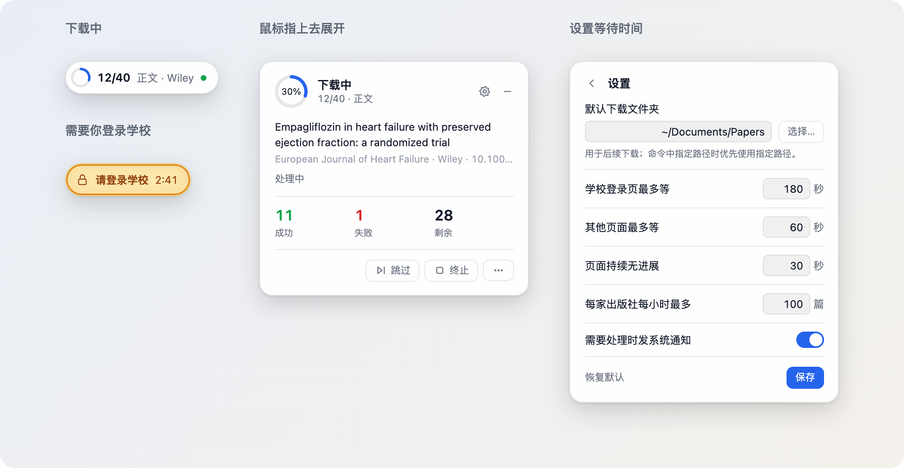

<p align="center">
  
</p>

<h1 align="center">PaperSearch</h1>

<p align="center"><b>让 AI 帮你查文献、核对引用、下载全文和补充材料。</b></p>

<p align="center">
  <a href="https://www.npmjs.com/package/papersearch"></a>
  
  
  <a href="https://linux.do"></a>
</p>

<p align="center">简体中文 | <a href="README.en.md">English</a></p>

PaperSearch 提供 `paper-search` 命令和一份随包 Skill。装好后，Claude Code、Codex、Cursor、Kimi Code、Qwen Code、CodeBuddy、TRAE 等支持本机命令调用的 AI 工具，就能替你检索 20 多个学术数据源、核对 DOI，把论文的 PDF 和补充材料下载下来并整理好。你也可以在终端或脚本里直接使用，输出默认是 JSON。

- **开放获取直接下载**：PubMed Central、Unpaywall、出版社接口等渠道，装好就能用。
- **学校订阅也能下**：可选的机构下载扩展经 CARSI 登录你的学校，批量获取学校有权限的论文和补充材料；支持自动过验证，放行后继续下载。
- **每一篇都核对过**：逐个核对 PDF 首页的 DOI 和题名，不是这篇文章的不算成功。
- **结果直接能用**：按“期刊_年份_标题”建文件夹，正文和补充材料放在一起；没下到的篇目说明原因。

<p align="center"></p>

[效果](#效果) | [快速开始](#快速开始) | [常见任务](#常见任务) | [工作方式](#工作方式) | [机构下载扩展](#机构下载扩展) | [检索来源](#检索来源) | [配置](#配置) | [Agent Skill](#agent-skill) | [命令](#命令) | [排障](#排障)

## 效果

对 AI 工具说一句话，例如：

> 找 2020 年以来 SGLT2 抑制剂治疗心力衰竭的随机对照试验，核对 DOI，把全文和补充材料下载到 ./downloads

AI 会调用 PaperSearch 检索、核验、下载，最后告诉你哪些拿到了、哪些没拿到以及原因。下面是一次实际下载的结果：

```text
downloads/
├── papers/
│   ├── Nutrients_2026_α-Ketoglutarate Alleviates the Pathogenesis…_0b6e0203de/
│   │   ├── Nutrients_2026_α-Ketoglutarate Alleviates the Pathogenesis….pdf
│   │   └── supplements/
│   │       └── nutrients-18-03600-s001.zip       补充材料保留原文件名
│   └── arXiv_2017_Attention Is All You Need_a1a0262a54/
│       └── arXiv_2017_Attention Is All You Need.pdf    预印本会标明
└── diagnostics/                                   运行记录、附件清单、截图
```

机构下载时，屏幕角落会出现进度胶囊：显示进度；需要你登录或验证时变成琥珀色提醒；鼠标指上去展开更多操作。

<p align="center"></p>

## 快速开始

要求 Node.js 18 及以上和 npm。

```bash
npm install -g papersearch
paper-search setup
paper-search doctor --format text
```

`paper-search setup` 会依次问三件事：API key 和邮箱；Skill 安装到通用目录还是工具专用目录；要不要安装机构下载扩展。每一步都可以跳过。`doctor` 显示现在能用哪些功能、还缺什么配置。

Skill 是教 AI 工具调用 `paper-search` 的说明文件，用 AI 工具做文献任务时要装。跳过了可以随时补装，`--targets` 换成你用的工具（`claude`、`codex`、`cursor`、`gemini`、`agents`，或 `all`）：

```bash
paper-search skills update --targets claude
```

Kimi Code、Qwen Code 使用 `--targets agents`，将 Skill 安装到共享目录。TRAE、CodeBuddy 的接入方式见下方 [Agent Skill](#agent-skill)。

也可以把下面这段话发给你的 AI 工具，让它帮你装：

```text
请帮我安装 PaperSearch：运行 npm install -g papersearch，再按 README 的 Agent Skill 说明为你自己安装随包 Skill（Kimi Code、Qwen Code 用 agents，Claude Code 用 claude，Codex 用 codex，Cursor 用 cursor；TRAE、CodeBuddy 使用各自的 Skill 目录），最后运行 paper-search doctor --format text，告诉我哪些功能能用、还缺哪些 key；再问我下载的论文默认放在哪个文件夹，用 paper-search config set DEFAULT_DOWNLOAD_PATH 保存。API key 我会自己在终端运行 paper-search setup 输入，不要让我发到聊天里。
```

**从旧包 `paper-search-cli` 升级**：先运行 `npm uninstall -g paper-search-cli`，再 `npm install -g papersearch`。两个包提供同一个 `paper-search` 命令，不能同时装；配置、Skill、学校登录和下载记录都会保留。

**以后升级**：`npm install -g papersearch@latest`。升级后第一次运行 `paper-search` 时，它会自动把你装过的 Skill 更新到新版本。

## 常见任务

```bash
# 检索论文（不需要任何 key 的来源组合）
paper-search search "machine learning clinical prediction" --sources no-key --max-results 5 --pretty

# 指定一个来源，例如 PubMed
paper-search search "SGLT2 inhibitor heart failure" --platform pubmed --max-results 10 --pretty

# 核验一个 DOI
paper-search run get_paper_by_doi --arg doi="10.1038/nature12373" --pretty

# 施引文献；参考文献把 get_paper_citations 换成 get_paper_references
paper-search run get_paper_citations --arg doi="10.1038/nature12373" --arg limit=5 --pretty

# 期刊影响因子和分区（需要 EasyScholar key）
paper-search journal-metrics "Nature" "BMJ" --pretty

# 在正文里找 Methods 写法（需要 Semantic Scholar key）
paper-search run search_semantic_snippets --arg query="propensity score matching" --arg limit=3 --pretty

# 下载一篇
paper-search download "<DOI>" --platform crossref

# 批量下载正文和补充材料（只要正文去掉 content；只要补充材料用 "supplements"）
paper-search run download_batch --json-args '{"items":[{"doi":"<DOI-1>"},{"doi":"<DOI-2>"}],"content":"both"}'

# 没下到的篇目和原因
paper-search failures --format text
```

## 工作方式

```text
用户的文献请求
│
├─ 找论文、核验 DOI/PMID → paper-search search（Crossref、PubMed、OpenAlex 等）
│    └─ 确认条目、需要全文 → 转到下面的“下载”
├─ 查施引文献、参考文献 → paper-search run get_paper_citations / get_paper_references
├─ 查影响因子、分区 → paper-search journal-metrics（需要 EasyScholar key）
├─ 找 Methods 写法、参数 → paper-search run search_semantic_snippets（需要 Semantic Scholar key）
│
└─ 下载正文、补充材料 → paper-search download / run download_with_fallback / run download_batch
     同一个下载命令，按顺序尝试：
     ├─ ① 开放下载（默认就有）：来源自带的下载、PMC、Unpaywall、出版社接口
     ├─ ② Sci-Hub 兜底（默认开启，可关闭）
     ├─ ③ 机构下载（可选扩展）：浏览器经 CARSI 登录你的学校，在出版社网站取 PDF 和补充材料
     ├─ ④ arXiv 预印本：前面都没拿到正式发表版时才用，并标明是预印本
     ├─ 每一步拿到文件都核对首页的 DOI 和题名；通过就保存，后面的步骤不再试
     └─ 都没拿到 → paper-search failures 说明原因
```

### 两种下载方式

|  | 开放下载（默认） | 机构下载（可选扩展） |
|---|---|---|
| 能不能直接用 | 装好就能用 | 要另外安装：`paper-search carsi install` |
| 能拿到什么 | 开放获取的正文 | 你的学校订阅的正文；有规则的出版社还能取补充材料 |
| 怎么拿 | 程序直接下载，通常几秒，不用登录：来源自带的下载、元数据里的 PDF 地址、PubMed Central、Unpaywall、出版社接口（你自己的 Elsevier/Springer key）；最后是默认开启的 Sci-Hub 兜底 | 打开一个浏览器，经 CARSI 登录你的学校，在出版社网站上取 PDF |
| 你要做的事 | 无 | 在浏览器里登录学校；程序自动过验证，需要人工接管时再按提示操作 |

两种方式用同一个下载命令：先试开放下载，拿不到时，装了机构下载才继续用学校权限。

- 几十到几百篇用一次 `download_batch`：先对所有篇目试开放渠道，再对没拿到正文的篇目用机构下载。结束后 `paper-search failures` 把没下到的篇目分成四类：没权限（附页面原话等依据）、需要你处理（登录、验证、等待）、暂不支持的网站、原因不明。
- arXiv 论文先找正式发表版，都没拿到才下载预印本；结果里写 `version: "preprint"`，已知时附正式版 DOI。
- 不想用 Sci-Hub 时，在 `download_with_fallback` / `download_batch` 里设 `"useSciHub": false`。
- 每个 PDF 都核对首页的 DOI 和题名；对不上的不算成功，单独留待核查。

### 下载结果

下载目录分两部分：`papers/` 放论文，每篇一个文件夹，正文按“期刊_年份_标题”命名，补充材料在该篇的 `supplements/` 里并保留原文件名；`diagnostics/` 放运行记录、附件清单和截图，查问题时用。文件夹名末尾的短标识用来区分同名论文。缺少期刊或年份时写“未知期刊”“未知年份”。旧版本下载的文件不会自动搬动，命令返回的 JSON 里写着每个文件的实际位置。

## 机构下载扩展

```bash
paper-search carsi install
paper-search carsi status --format text
```

- 安装时会问你的学校（CARSI 成员学校，中文名、英文名或域名都可以），并下载专用浏览器 Camoufox，共约 3 GB；macOS 上 `--browser ego` 改用 ego lite，约 0.5 GB。`--skip-school` 可以以后再选学校。
- 目前用 CARSI（中国高校身份联盟）登录学校；出版社的机构列表里没有 CARSI 或你的学校时，程序会立即说明。
- 自动过验证：程序自动定位并点击验证框，网站放行后继续下载。每次验证等待最多尝试 3 次，两次至少间隔 3 秒；点击或勾选本身不代表验证已经通过。
- 下载时屏幕角落会出现进度胶囊：显示进度、正在下正文还是附录、哪家出版社；需要你登录或验证时变成琥珀色，背景与边缘轻柔呼吸，并在开启系统通知时发送通知；点击“请登录学校”等提醒可切到当前任务的下载浏览器。鼠标指上去展开，可以跳过本篇、标记本刊或出版社无权限、终止整个任务、报告问题，右上角齿轮调整等待时间和默认下载文件夹，“–”最小化；按住胶囊或展开卡片的非按钮区域可拖动。停在学校登录页默认最多等 3 分钟，停在其他页面（人机验证、出版社页面等）默认 1 分钟后结束这一篇。
- 默认下载浏览器在后台继续运行，启动、点击和跳转时不主动抢前台，也不会自动最小化或隐藏窗口；需要登录或验证时由胶囊提示，点击提醒即可切到浏览器处理。完成检查但页面未列出附件会显示“已检查，页面未列出补充材料”，不计为失败；登录未完成、暂不支持发现附件或下载失败会分别说明。
- 默认下载文件夹可在胶囊设置中选择或输入，也可运行 `paper-search config set DEFAULT_DOWNLOAD_PATH "/完整路径/论文"`。保存后用于新任务；`--save-path` 或 `savePath` 可为单次任务指定其他目录，正在运行的批次保持原目录。
- 胶囊齿轮新增“页面持续无进展”，默认 30 秒，可保存为 1–600 秒，并可恢复默认。学校账号登录立即提醒；其他页面持续无进展达到设定时间后，胶囊才变色呼吸、提示查看浏览器。自动通过保持安静，恢复进展后清除提醒；主页面仍在导航加载时，在原页面等待上限内暂不提醒；持续接收文件也不会被当作页面卡住。该设置只改变提醒时间，不延长页面等待上限。
- 机构登录中，你在专用登录页输入、选择或点击控件，或点击胶囊接管后，暂停登录等待倒计时；输入间的停顿不消耗剩余时间。离开人工登录步骤后继续计时；无人操作仍按原限时结束。
- macOS 通知改用 PaperSearch 自己的名称和图标，点击通知与点击胶囊提醒共用当前任务的浏览器恢复入口。首次配置机构下载扩展时可选择是否开启系统通知，新配置默认关闭；胶囊齿轮里的“系统通知”开关点击即保存，已有选择在升级后保留。关闭通知仍保留琥珀色呼吸提醒。无需另外安装通知工具；开启后横幅显示仍遵循 macOS 通知权限与专注模式设置。
- 能取哪些出版社的正文和补充材料，见 [出版社支持表](skills/paper-search/references/publisher-support.md)。正文和补充材料都实测取得的有 Elsevier、Wiley、Springer Nature、OUP、Wolters Kluwer、Taylor & Francis、Sage、ACS、NEJM、ASCE、Dove 等，另已实测取得 ASH、Thieme、PLOS、Copernicus、Annual Reviews、IOP、AMS、APS、Optica、IEEE、World Scientific、MDPI、Frontiers 的补充材料及论文关联的 Figshare 附件；尚未取得的附件入口仍在补全；表里没有的网站按通用规则尝试。
- `paper-search carsi update` 在 PaperSearch 升级后更新扩展，`paper-search carsi uninstall` 卸载（默认保留浏览器和学校配置）。
- Windows：PowerShell 拦住 `npm.ps1` 时改用 `npm.cmd` 或命令提示符；下载要在桌面会话里运行，经 SSH 或系统服务启动时浏览器窗口打不开。

## 检索来源

| 类别 | 来源 | 需要的 API key |
|---|---|---|
| 综合学术元数据 | Crossref、OpenAlex、Semantic Scholar、Google Scholar | 不需要（Semantic Scholar 的正文片段检索需要） |
| 生物医学 | PubMed、PubMed Central、Europe PMC | 不需要（PubMed key 可提高限额） |
| 预印本和会议稿 | arXiv、bioRxiv、medRxiv、OpenReview、IACR ePrint | 不需要 |
| 计算机和工程 | DBLP、ACM、USENIX | 不需要 |
| 开放获取和仓储 | CORE、OpenAIRE、Unpaywall | Unpaywall 填邮箱；CORE、OpenAIRE 可选 |
| 出版社和引文库 | ScienceDirect、Scopus、Springer Nature、IEEE Xplore、Web of Science | 需要各自的 key（ScienceDirect、Scopus 共用 Elsevier key） |
| 期刊指标 | EasyScholar | 需要 |

- 不需要 key 的来源已经收录了各大出版社的论文；配了 key，多的是出版社自己的检索入口。
- 单个来源用 `--platform`，多个用 `--sources a,b,c`；`--sources no-key` 是不需要任何 key 的组合（Crossref、PubMed、Europe PMC、arXiv、OpenReview）。
- Google Scholar 是网页解析，容易触发验证，不在 `--sources all` 里；需要时用 `--platform googlescholar`。
- 多个来源返回同一篇论文时按 DOI 合并；arXiv 预印本和正式发表版有明确 DOI 关联时，保留正式发表记录。
- Sci-Hub 不是检索来源，只在下载时按 DOI 兜底。

## 配置

PaperSearch 有两套配置，各管各的，都可以不配：

|  | API key | CARSI（机构下载扩展） |
|---|---|---|
| 用来做什么 | 部分来源的检索、期刊指标、正文片段检索；Elsevier、Springer 的 key 还能经出版社接口取全文 | 登录你的学校，按学校订阅下载全文和补充材料 |
| 怎么配 | `paper-search setup`，或 `paper-search config set` | `paper-search carsi install`，安装时选学校 |
| 不配时 | 用免费来源检索；“检索来源”里需要 key 的来源和功能不可用 | 下载只走开放下载渠道（见[两种下载方式](#两种下载方式)） |

### API key 与配置文件

多数免费来源不需要配置。建议先运行 `paper-search setup`，把 key 写入用户配置：

```bash
paper-search setup
paper-search config list --pretty
paper-search config set SEMANTIC_SCHOLAR_API_KEY <你的 key>
```

配置文件在 `~/.config/paper-search-cli/config.json`（权限 `0600`；文件夹沿用旧名，升级不丢设置），`config list` 和 `doctor` 会把 key 脱敏显示。

| 配置项 | 用途 | 什么时候配置 |
|---|---|---|
| `DEFAULT_DOWNLOAD_PATH` | 下载的论文默认存放的文件夹；不设置时存到命令当前目录下的 `./downloads` | 第一次配置时；也可以在进度胶囊的设置里改 |
| `SEMANTIC_SCHOLAR_API_KEY` | 正文片段检索，更稳定的 Semantic Scholar 请求 | 要查方法细节，或经常用 Semantic Scholar |
| `UNPAYWALL_EMAIL` | 按 DOI 找开放获取 PDF | 推荐配置；填邮箱即可 |
| `CROSSREF_MAILTO` | Crossref 优先通道 | 长任务或高频检索 |
| `CORE_API_KEY` | CORE 仓储检索 | 经常用 CORE 或遇到限流 |
| `EASYSCHOLAR_KEY` | 期刊指标 | 要查影响因子、分区；用 `paper-search setup EASYSCHOLAR_KEY` 隐藏输入 |
| `PUBMED_API_KEY`、`NCBI_EMAIL` | PubMed 更高限额 | 经常用 PubMed |
| `WOS_API_KEY`、`IEEE_API_KEY`、`ELSEVIER_API_KEY`、`SPRINGER_API_KEY` | 各自的元数据；Elsevier、Springer 的 key 也用于出版社接口取全文（权限跟随你的网络或 key） | 要用对应来源时 |
| `ELSEVIER_INSTTOKEN` | 校外经 Elsevier 接口取全文 | 校外需要全文时；校园网不需要 |
| `GOOGLE_SCHOLAR_PROXY_URL` | Google Scholar 的出口代理 | 直连反复被拦时，用有授权的代理 |
| `PAPER_SEARCH_CARSI_ENABLED` | 机构下载扩展的开关 | `paper-search carsi install` 自动设置 |
| `PAPER_SEARCH_SKILL_AUTO_UPDATE` | 设为 `false` 时，升级后不再自动更新已安装的 Skill | 默认开启，想自己管理 Skill 时设置 |

申请入口：[EasyScholar](https://www.easyscholar.cc/console/user/open) · [Semantic Scholar](https://www.semanticscholar.org/product/api) · [Unpaywall](https://unpaywall.org/products/api) · [CORE](https://core.ac.uk/services/api) · [NCBI](https://ncbiinsights.ncbi.nlm.nih.gov/2017/11/02/new-api-keys-for-the-e-utilities/) · [Web of Science](https://developer.clarivate.com/apis) · [IEEE Xplore](https://developer.ieee.org/docs/read/Searching_the_IEEE_Xplore_Metadata_API) · [Elsevier](https://dev.elsevier.com/apikey/manage) · [Springer Nature](https://dev.springernature.com/) · [OpenAIRE](https://develop.openaire.eu/)

### CARSI

安装和使用见 [机构下载扩展](#机构下载扩展)。它不用任何 API key，也不提供检索。

## Agent Skill

Skill 随 npm 包发布（`skills/paper-search/`），全中文，开头有整体逻辑图，按需读这些参考文件：功能路由与开放下载的各个渠道、命令约定、机构下载的安装和使用、[出版社支持表](skills/paper-search/references/publisher-support.md)、排障。它只告诉 AI 怎么调用 `paper-search`，不保存 key、Cookie 或账号。

```bash
paper-search skills status --pretty
paper-search skills update --targets claude
```

国内 AI 工具可以按以下方式加载同一份 Skill：

| 工具 | 接入方式 |
|---|---|
| [Kimi Code](https://www.kimi.com/code/docs/kimi-code-cli/customization/skills.html)、[Qwen Code](https://github.com/QwenLM/qwen-code/blob/main/docs/users/features/skills.md) | 运行 `paper-search skills update --targets agents`，安装到它们共同支持的 `~/.agents/skills/paper-search/` |
| [TRAE](https://docs.trae.ai/ide/skills?_lang=zh) | 将随包 Skill 文件夹复制到项目的 `.trae/skills/paper-search/` |
| [CodeBuddy](https://www.codebuddy.ai/docs/zh/ide/Features/Skills) | 将随包 Skill 文件夹复制到项目的 `.codebuddy/skills/paper-search/` |

`npm root -g` 可查看全局 npm 目录；随包 Skill 位于其下的 `papersearch/skills/paper-search/`。复制时保留完整文件夹及 `references/`，更新时从新版本复制。安装后新开 AI 会话即可使用。

- 支持的目标：`agents`、`codex`、`claude`、`cursor`、`gemini`、`antigravity`、`all`。更新会覆盖包里管理的文件，保留你在 Skill 目录里自己加的文件。
- **升级后自动更新**：通过内置目标安装的 Skill，会在升级 PaperSearch 后第一次运行 `paper-search`（`skills`、`setup` 除外）时更新到新版本：只更新原来装过的位置；被替换的旧文件备份在 `~/.local/share/paper-search-cli/skill-backups/`；并在 stderr 写一行说明。一个都没装时只提示一次怎么装。不想自动更新：`paper-search config set PAPER_SEARCH_SKILL_AUTO_UPDATE false`。
- `paper-search doctor` 显示内置安装目标中的 Skill 位置和版本状态。

### 新版提醒（0.4.8 新增）

发现 npm 上有新的稳定版本时，日常调用会在终端提示当前版本、最新版本和升级命令。在线任务期间异步检查，成功结果缓存 24 小时；检查失败不会影响文献任务，命令结束即取消未完成的检查。提醒写入 stderr，stdout 的 JSON 不变；离线管理命令只使用缓存，CI、帮助和配置命令不自动提醒。

```bash
paper-search update check --format text
paper-search config set PAPER_SEARCH_UPDATE_NOTIFY false  # 关闭自动检查和提醒
paper-search config set PAPER_SEARCH_UPDATE_NOTIFY true   # 重新开启
```

不会自动安装更新。升级 CLI 后，已安装的 Skill 会按现有规则同步；机构下载扩展仍用 `paper-search carsi update` 更新。此开关与胶囊的系统通知开关独立。

## 命令

| 命令 | 用途 |
|---|---|
| `paper-search search` | 检索论文元数据 |
| `paper-search journal-metrics` | 期刊指标（EasyScholar） |
| `paper-search download` | 下载已核验论文的 PDF |
| `paper-search run <工具>` | 精确调用某个工具，参数用 `--arg` 或 `--json-args` |
| `paper-search failures` | 汇总下载失败的原因 |
| `paper-search update check` | 检查 npm 稳定新版（0.4.8 新增） |
| `paper-search carsi` | 机构下载扩展的安装、状态、更新、卸载 |
| `paper-search setup` / `config` | 配置 key、Skill 和扩展 |
| `paper-search doctor` | 健康检查：配置、可用功能、Skill 和扩展的状态 |
| `paper-search skills` | Skill 的状态、差异和更新 |
| `paper-search smoke` | 离线或真实的自检 |
| `paper-search tools` | 列出所有工具名和参数 |

命令默认输出 JSON，`--pretty` 排版，`--format text` 输出给人看的报告。完整命令见 `paper-search tools --pretty` 或 [命令约定](skills/paper-search/references/cli-contract.md)。

## 排障

| 问题 | 怎么办 |
|---|---|
| 找不到 `paper-search` 命令 | `npm install -g papersearch` 重新安装 |
| 安装时报 `EEXIST` | 旧包还在：先 `npm uninstall -g paper-search-cli` |
| 某个功能不能用 | `paper-search doctor --format text` 看缺什么，再 `paper-search setup` 配置 |
| 学校订阅的文章下载不到 | `paper-search carsi status --format text` 看扩展是否装好；`paper-search failures --format text` 看每篇的原因 |
| 来源限流 | 减小 `--max-results`、配置对应 key，或换来源 |
| Google Scholar 出验证页 | 等一会儿再试，或改用 `--sources no-key` |
| AI 读到的 Skill 是旧的 | `paper-search skills status --pretty`，再 `paper-search skills update --targets <工具>`；新开一个 AI 会话 |

## 路线图与参与

- 接下来的重点：批量下载更稳、新电脑安装更顺；在 PDF 之外交付全文包（原始 XML/HTML、Markdown 和正文图片）。详见 [路线图](docs/ROADMAP.zh.md)。
- 想了解原理和代码结构：[架构说明](docs/ARCHITECTURE.zh.md)。
- 下载失败或想要支持某家出版社：使用“下载失败 / 想支持某家出版社”Issue 模板，说明版本、系统、网站和 DOI。
- 0.4.8 新增：`paper-search failures --export ./failure-report.zip` 导出最近一批机构下载失败记录；可加 `--run <运行ID> --doi <DOI>` 筛选，也包含正文成功但附件失败的条目。请先检查包内 `summary.md`、HTML 与截图中的个人信息，再手动附到 Issue。导出只处理副本，不改原记录、不重跑或上传；旧记录没有的 HTML 会标为缺失。已安装版本没有该命令时，先提供版本和现象，勿上传原始诊断。
- 想自己加出版社规则：见 [carsi/CONTRIBUTING.md](carsi/CONTRIBUTING.md)。

## 使用边界

部分来源受平台条款、机构订阅或当地法律约束，只在你有相应访问权时使用。机构下载用的是你自己的学校账号和订阅；结果里的来源标记只用于诊断，不能当作授权证明。

## 项目来源

- 感谢 [LinuxDo](https://linux.do) 社区：命令 + Skill 的路线和工作流改进来自社区交流与开源分享。
- [openags/paper-search-mcp](https://github.com/openags/paper-search-mcp)：本项目参考了它的思路，并改成独立的命令行工具。
- [Rimagination/scansci-pdf](https://github.com/Rimagination/scansci-pdf)（MIT）：机构下载后端（`carsi/`）借鉴了它的架构（CARSI 等联盟登录、出版社网站抓取、会话复用、PDF 捕获）；原项目的版权声明保留在 `carsi/NOTICE`。

## License

MIT
