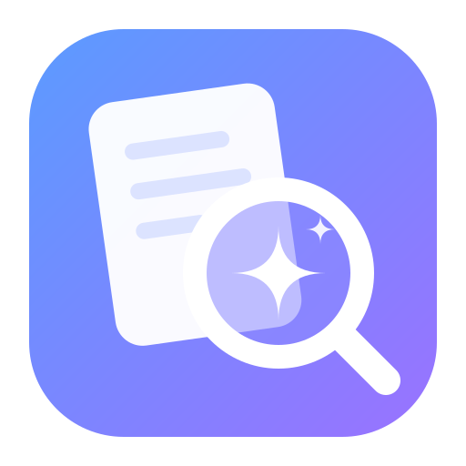
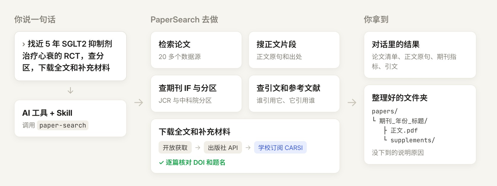
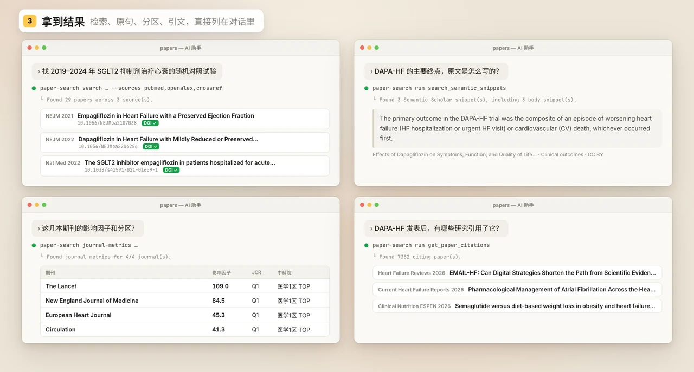
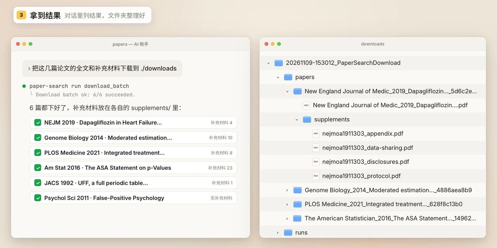

<p align="center">
  
</p>

<h1 align="center">PaperSearch</h1>

<p align="center"><b>轻量、全自动的 AI 文献全能工具</b><br>
一句话让AI完成文献检索、核对、下载全文和补充材料，后台自动完成。</p>

<p align="center">简体中文 | <a href="README.en.md">English</a></p>

<p align="center">
  <a href="https://www.npmjs.com/package/papersearch"></a>
  <a href="https://github.com/dr-dumpling/PaperSearch/actions/workflows/publish.yml"></a>
  <a href="https://nodejs.org/"></a>
  <a href="#1-学校订阅下载carsi"></a>
  <a href="docs/guide.zh.md#agent-skill"></a>
  <a href="#快速开始"></a>
  <a href="LICENSE"></a>
  <a href="https://linux.do/"></a>
</p>

<p align="center">
  <a href="#演示视频">演示视频</a> · <a href="#快速开始">快速开始</a> · <a href="#1-学校订阅下载carsi">学校订阅下载</a> · <a href="#2-api-key">API key</a> · <a href="docs/guide.zh.md">使用说明</a> · <a href="docs/ARCHITECTURE.zh.md">架构说明</a> · <a href="docs/ROADMAP.zh.md">路线图</a> · <a href="https://github.com/dr-dumpling/PaperSearch/issues/new/choose">反馈问题</a>
</p>

PaperSearch 提供 `paper-search` 命令和一份随包 Skill。装好后，Claude Code、Codex、DeepSeek、GLM、Kimi Code、Qwen Code、CodeBuddy 等支持本机命令调用的 AI 工具，就能替你：

- **检索论文**：一次查 PubMed、Crossref、OpenAlex、Semantic Scholar、arXiv 等 20 多个数据源，按 DOI 合并重复，核对 DOI。
- **搜正文片段**：利用 Semantic Scholar 收录的论文正文，搜原句，找到方法、结果的原文和出处。
- **查期刊 IF 与分区**：利用 EasyScholar，查找 JCR 影响因子、JCR 分区和中科院分区。
- **查引文和参考文献**：顺着一篇论文，找出引用它的研究和它引用的文献。
- **下载全文和补充材料**：
  - OA 文章：直接下载。
  - 非 OA 文章：通过“[学校订阅下载（CARSI）](#1-学校订阅下载carsi)”（推荐）或 [API key](#2-api-key) 配置。

<p align="center"></p>

## 演示视频


https://github.com/user-attachments/assets/c6ba529d-0b4e-4c2a-82cb-1ef8ba53274c


## 快速开始

### 1. 安装

把这句话发给你的 AI 工具（Claude Code、Codex、DeepSeek、GLM、Kimi Code、Qwen Code、CodeBuddy 等等都行）：

```text
请帮我安装 PaperSearch 的 Skill：npx skills add dr-dumpling/PaperSearch -g -y
```

Windows 上这条命令需要 Git，没有的话先装 [Git for Windows](https://git-scm.com/download/win)。

装好后引用 Skill，发这句：

```text
/paper-search 请开始配置
```

AI 会先问你要不要装 PaperSearch 的命令行程序，你同意后装好，再带你配置学校订阅下载（CARSI）和 API key。

<p align="center"></p>

### 2. 配置时装上学校订阅下载

说了“请开始配置”后，AI 会先问你要不要装[学校订阅下载（CARSI）](#1-学校订阅下载carsi)：用学校账号下载非 OA 文章的全文和补充材料，需要 Chrome（没有的话一起装），下载约 0.5 GB。你同意后它才安装，装完问你的学校并设好，然后弹出设置窗口。

- 不要的话说一声就跳过，之后不再提；检索和 OA 文章下载照常能用。
- 没有图形界面的服务器上不问、不装。

<p align="center"></p>

### 3. 按需填 API key

说了“请开始配置”后，AI 先问你要不要用学校订阅下载，再按你的选择一步步来：

- **用学校订阅下载**：API key、下载文件夹、等待时间和提醒都在设置窗口里填，每个 key 都能点“测试”。之后想改，让 AI 打开设置，或点胶囊上的齿轮。
- **不用**：AI 列出还缺的 key 和申请入口（也见 [API key](#2-api-key)），你在终端运行 `paper-search setup` 填入，输入时不显示；填完 AI 逐个测试能不能用。

### 4. 开始使用

配置好后，引用 PaperSearch 的 Skill，说出你需要搜索的内容，比如：

| 想做什么 | 可以这样说 |
|---|---|
| 检索论文 | `/paper-search` 找 2020 年以来 SGLT2 抑制剂治疗心力衰竭的随机对照试验，核对 DOI |
| 搜正文片段 | `/paper-search` 这些试验的主要终点，原文是怎么定义的？摘几段原文 |
| 查期刊 IF 与分区 | `/paper-search` 它们发表在哪些期刊？影响因子和分区各是多少 |
| 查引文和参考文献 | `/paper-search` DAPA-HF 试验发表后，有哪些研究引用了它 |
| 下载全文和补充材料 | `/paper-search` 把这些论文的全文和补充材料下载到 ./downloads |

**拿到结果：**

<p align="center"></p>

<p align="center"></p>

- 检索、正文片段、期刊指标和引文，直接在对话里列给你。
- 每次下载在下载文件夹里新建一个 `年月日-时分秒_PaperSearchDownload` 文件夹：只下正文时 PDF 直接放在里面，带补充材料时每篇一个文件夹，补充材料在 supplements/ 里；没拿到的篇目告诉你原因。

## 可选配置

功能对比：

| | 装好就能用 |  API key | 学校订阅下载（CARSI） |
|---|:---:|:---:|:---:|
| **检索** | | | |
| &emsp;检索论文、查引文和参考文献 | ✅ | — | — |
| &emsp;更多检索来源、限额 | — | ✅ | — |
| **期刊与正文** | | | |
| &emsp;查影响因子和分区 | — | ✅ | — |
| &emsp;搜正文片段 | — | ✅ | — |
| **下载** | | | |
| &emsp;下载 OA 文章 | ✅ | — | — |
| &emsp;下载非 OA 文章 | — | ✅（Elsevier、Springer） | ✅（30+主流出版社） |
| &emsp;下载补充材料 | — | — | ✅ |
| **需要准备** | Node.js 22 或以上 | 到各家网站申请 key | Google Chrome、学校账号 |
| **怎么开启** | 快速开始第 1 步 | 设置窗口或终端 | 配置时同意安装 |

### 1. 学校订阅下载（CARSI）

开放渠道下不到的论文，可以借你学校的订阅来下。CARSI 是中国高校身份联盟，国内高校基本都已加入，用学校账号就能登录各家出版社。

- **学校账号就能用**：不用另外申请 key；出版社 API key 只覆盖 Elsevier、Springer 两家。
- **深度适配出版社**：深度优化了下载的通用流程，并且针对 30 多家出版社逐家写了专门规则，机构登录入口在哪、PDF 和补充材料怎么取，都按各自出版社的实际情况来，下载更准、更少漏篇。优化的出版社主要有：
  - 综合：Elsevier（含 Cell、Lancet）、Springer Nature（含 Nature、BMC）、Wiley、Oxford Academic、Taylor & Francis、Sage、PNAS、Science
  - 医学：NEJM、JAMA、AHA、ASH、Wolters Kluwer、Karger、Thieme
  - 理工：ACS、IEEE、ACM
  - 完整列表见 [出版社支持表](skills/paper-search/references/publisher-support.md)
  - 需要支持别的出版社，欢迎[提 Issue](https://github.com/dr-dumpling/PaperSearch/issues/new/choose)，附上一篇你有权限的文章 DOI；适配规则会持续维护和更新。
- **验证框自动点击**：遇到人机验证，程序自动定位并点击，网站放行后继续下载；过不去才提醒你。
- **后台下载不打扰**：浏览器在后台工作。屏幕角落的进度胶囊显示进度；需要你登录学校或手动验证时变成琥珀色，点一下就切到浏览器，处理完程序接着下载。

安装：

```bash
paper-search carsi install                # 安装时选择你的学校
paper-search carsi status --format text   # 查看是否装好
```

**进度胶囊**

<p align="center"></p>

**自动过验证**

<p align="center"></p>

**自动登录学校**

<p align="center"></p>

**需要你时提醒**

<p align="center"></p>

**结束清单**

<p align="center"></p>

### 2. API key

按用途分四类，需要哪类就申请对应的 key（邮箱直接填，不用申请），再用[快速开始第 3 步](#3-按需填-api-key)里的任一方式填入。

#### 查期刊、搜正文、找免费全文（推荐配置）

| 功能 | 要填的 key | 去哪里申请 |
|---|---|---|
| 查影响因子和分区 | `EASYSCHOLAR_KEY` | [EasyScholar](https://www.easyscholar.cc/)（[申请教程](https://docs.qq.com/aio/DTUxwZ3hUckVtZVJN)） |
| 搜正文片段 | `SEMANTIC_SCHOLAR_API_KEY` | [Semantic Scholar](https://www.semanticscholar.org/product/api)（[申请教程](https://docs.qq.com/aio/DTW9RdFVHc2hJUmpx)） |
| 下载时找免费全文 | `PAPER_SEARCH_UNPAYWALL_EMAIL` | 不用申请（[Unpaywall 说明](https://unpaywall.org/products/api)） |

#### 下载订阅全文（非必须）

| 出版社 | 要填的 key | 去哪里申请 |
|---|---|---|
| Elsevier | `ELSEVIER_API_KEY`；校外下订阅文章还要 `ELSEVIER_INSTTOKEN` | [Elsevier](https://dev.elsevier.com/apikey/manage) |
| Springer | `SPRINGER_API_KEY` | [Springer Nature](https://dev.springernature.com/) |

#### 增加检索来源（非必须）

| 来源 | 要填的 key | 去哪里申请 |
|---|---|---|
| Web of Science | `WOS_API_KEY` | [Clarivate](https://developer.clarivate.com/apis) |
| IEEE Xplore | `IEEE_API_KEY` | [IEEE](https://developer.ieee.org/docs/read/Searching_the_IEEE_Xplore_Metadata_API) |
| ScienceDirect、Scopus | `ELSEVIER_API_KEY`（和上面同一个） | [Elsevier](https://dev.elsevier.com/apikey/manage) |
| Springer | `SPRINGER_API_KEY`（和上面同一个） | [Springer Nature](https://dev.springernature.com/) |

#### 检索更快、更稳定（非必须）

| 来源 | 要填的 key | 去哪里申请 |
|---|---|---|
| Crossref（检索论文、核对 DOI 是否真实） | `CROSSREF_MAILTO` | 不用申请（[说明](https://www.crossref.org/documentation/retrieve-metadata/rest-api/tips-for-using-the-crossref-rest-api/)） |
| PubMed | `PUBMED_API_KEY` | [NCBI](https://ncbiinsights.ncbi.nlm.nih.gov/2017/11/02/new-api-keys-for-the-e-utilities/) |
| OpenAlex（被引超过 1 万篇时列全） | `OPENALEX_API_KEY` | [OpenAlex](https://openalex.org/settings/api) |
| CORE | `CORE_API_KEY` | [CORE](https://core.ac.uk/services/api) |
| OpenAIRE | `OPENAIRE_API_KEY` | [OpenAIRE](https://develop.openaire.eu/) |

配置保存在 `~/.config/paper-search-cli/config.json`，只有你自己能读。下载文件夹、代理和自动更新等其他设置，见 [使用说明 · 其他设置](docs/guide.zh.md#其他设置)。

## 更多文档

[使用说明](docs/guide.zh.md)：[命令示例](docs/guide.zh.md#命令示例)、[工作方式](docs/guide.zh.md#工作方式)、[检索来源](docs/guide.zh.md#检索来源)、[Agent Skill](docs/guide.zh.md#agent-skill)、[全部命令](docs/guide.zh.md#全部命令)、[排障](docs/guide.zh.md#排障)。也可以在终端运行 `paper-search tools --pretty` 查看全部工具和参数。

[更新记录](CHANGELOG.md)：每个版本按安装与配置、检索与核对、开放下载、学校订阅下载、进度窗口、下载结果、文档七个方面列出。

## 路线图

接下来计划做这几件事：

1. **进度胶囊优化**：提醒时机更准，学校登录页能自动放行时不提前打扰；减少 Windows 上浏览器启动、换页时短暂跳到前台的情况，优化显示效果。
2. **并行下载**：不同出版社之间并行下载，同时处理多篇，缩短几十上百篇的总耗时；每家出版社仍遵守下载上限。
3. **Markdown 全文包**：除了 PDF，再交付原始 XML/HTML、Markdown 阅读副本和正文图片，图号、图注和正文引用一一对应，方便直接交给 AI 阅读和引用。
4. **更多学校访问方式**：除了中国的 CARSI，支持其他国家的学术身份联盟（如美国 InCommon、英国 UK federation）；有条件的话再接入 WebVPN、EZProxy 等访问方式。
5. **检索论文、搜正文片段再优化**：参考同类工具的做法，进一步提升检索论文和搜正文片段的效果。

完整计划见 [路线图](docs/ROADMAP.zh.md)，原理和代码结构见 [架构说明](docs/ARCHITECTURE.zh.md)。还想要什么功能，欢迎提 [Issue](https://github.com/dr-dumpling/PaperSearch/issues/new/choose) 和 PR；下载失败或想支持某家出版社，请用对应的 Issue 模板，想自己加出版社规则见 [carsi/CONTRIBUTING.md](carsi/CONTRIBUTING.md)。

## 致谢

- 感谢 [LINUX DO 社区](https://linux.do/)：命令 + Skill 的路线和工作流改进来自社区交流与开源分享。
- [openags/paper-search-mcp](https://github.com/openags/paper-search-mcp)：本项目参考了它的思路，并改成独立的命令行工具。
- [Dianel555/paper-search-mcp-nodejs](https://github.com/Dianel555/paper-search-mcp-nodejs)（MIT）：命令行版最初由它的 Node.js 实现改编而来。
- [Rimagination/scansci-pdf](https://github.com/Rimagination/scansci-pdf)（MIT）：机构下载后端（`carsi/`）借鉴了它的架构（CARSI 等联盟登录、出版社网站抓取、会话复用、PDF 捕获）。

## License

MIT
