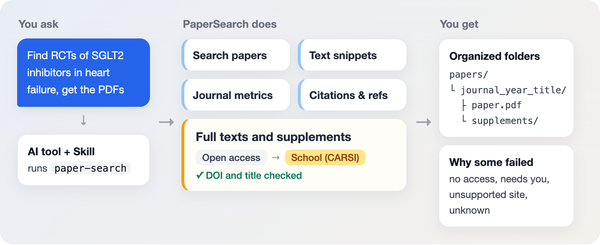
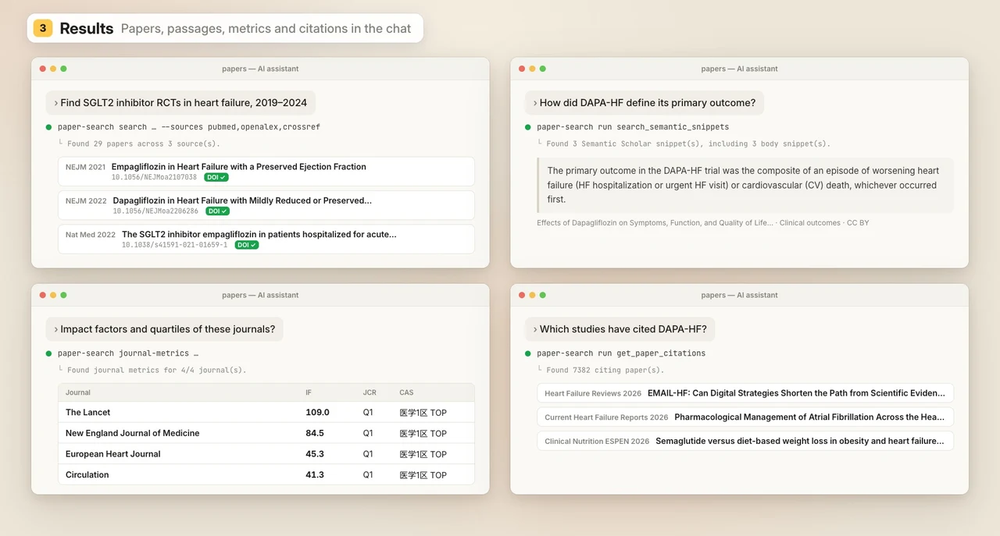
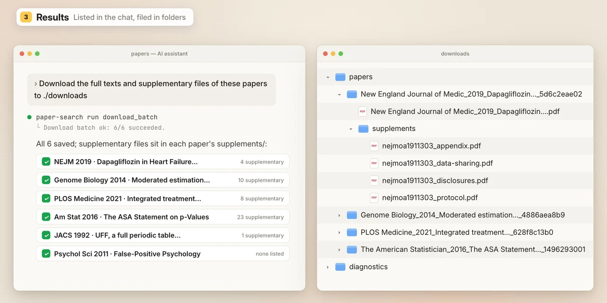
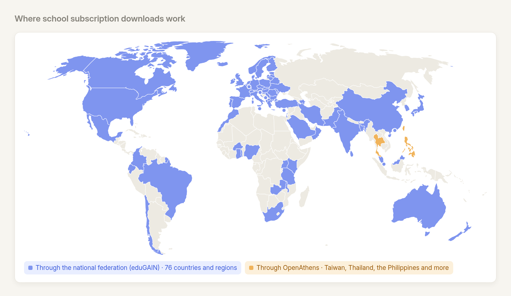

<p align="center">
  
</p>

<h1 align="center">PaperSearch</h1>

<p align="center"><b>輕量、全自動的 AI 文獻全能工具</b><br>
一句話讓AI完成文獻檢索、核對、下載全文和補充材料，後台自動完成。</p>

<p align="center"><a href="README.md">简体中文</a> | 繁體中文 | <a href="README.en.md">English</a> | <a href="README.ja.md">日本語</a> | <a href="README.ko.md">한국어</a> | <a href="README.fr.md">Français</a></p>

<p align="center">
  <a href="https://www.npmjs.com/package/papersearch"></a>
  <a href="https://github.com/dr-dumpling/PaperSearch/actions/workflows/publish.yml"></a>
  <a href="https://nodejs.org/"></a>
  <a href="#1-學校訂閱下載"></a>
  <a href="docs/guide.zh-Hant.md#agent-skill"></a>
  <a href="#快速開始"></a>
  <a href="LICENSE"></a>
  <a href="https://linux.do/"></a>
</p>

<p align="center">
  <a href="#演示影片">演示影片</a> · <a href="#快速開始">快速開始</a> · <a href="#1-學校訂閱下載">學校訂閱下載</a> · <a href="#2-api-key">API key</a> · <a href="docs/guide.zh-Hant.md">使用說明</a> · <a href="docs/ARCHITECTURE.zh.md">架構說明</a> · <a href="docs/ROADMAP.zh.md">路線圖</a> · <a href="https://github.com/dr-dumpling/PaperSearch/issues/new/choose">反饋問題</a>
</p>

PaperSearch 提供 `paper-search` 命令和一份隨包 Skill。裝好後，Claude Code、Codex、DeepSeek、GLM、Kimi Code、Qwen Code、CodeBuddy 等支援本機命令調用的 AI 工具，就能替你：

- **檢索論文**：一次查 PubMed、Crossref、OpenAlex、Semantic Scholar、arXiv 等 20 多個資料源，按 DOI 合併重複，核對 DOI。
- **搜正文片段**：利用 Semantic Scholar 收錄的論文正文，搜原句，找到方法、結果的原文和出處。
- **查期刊 IF 與分區**：利用 EasyScholar，查找 JCR 影響因子、JCR 分區和中科院分區。
- **查引文和參考文獻**：順著一篇論文，找出引用它的研究和它引用的文獻。
- **下載全文和補充材料**：
  - OA 文章：直接下載。
  - 非 OA 文章：通過「[學校訂閱下載](#1-學校訂閱下載)」（推薦）或 [API key](#2-api-key) 配置。

<p align="center"></p>

## 演示影片


https://github.com/user-attachments/assets/6c75c5de-9dd5-42e0-9dea-f44a1b4f3aac


## 快速開始

### 1. 安裝

把這句話發給你的 AI 工具（Claude Code、Codex、DeepSeek、GLM、Kimi Code、Qwen Code、CodeBuddy 等等都行）：

```text
請幫我安裝 PaperSearch 的 Skill：npx skills add dr-dumpling/PaperSearch -g -y
```

Windows 上這條命令需要 Git，沒有的話先裝 [Git for Windows](https://git-scm.com/download/win)。

裝好後引用 Skill，發這句：

```text
/paper-search 請開始配置
```

AI 會先問你要不要裝 PaperSearch 的命令行程式，你同意後裝好，再帶你配置學校訂閱下載和 API key。

<p align="center"></p>

### 2. 配置時裝上學校訂閱下載

說了「請開始配置」後，AI 會先問你要不要裝[學校訂閱下載](#1-學校訂閱下載)：用學校帳號下載非 OA 文章的全文和補充材料，需要 Chrome（沒有的話一起裝）。你同意後它才安裝，裝完問你的學校並設好，然後彈出設定視窗。

<p align="center"></p>

### 3. 按需填 API key

說了「請開始配置」後，AI 先問你要不要用學校訂閱下載，再按你的選擇一步步來：

- **用學校訂閱下載**：API key、下載資料夾、等待時間和提醒都在設定視窗里填，每個 key 都能點「測試」。之後想改，讓 AI 打開設定，或點膠囊上的齒輪。
- **不用**：AI 列出還缺的 key 和申請入口（也見 [API key](#2-api-key)），你在終端執行 `paper-search setup` 填入，輸入時不顯示；填完 AI 逐個測試能不能用。

### 4. 開始使用

配置好後，引用 PaperSearch 的 Skill，說出你需要搜尋的內容，比如：

| 想做什麼 | 可以這樣說 |
|---|---|
| 檢索論文 | `/paper-search` 找 2020 年以來 SGLT2 抑制劑治療心力衰竭的隨機對照試驗，核對 DOI |
| 搜正文片段 | `/paper-search` 這些試驗的主要終點，原文是怎麼定義的？摘幾段原文 |
| 查期刊 IF 與分區 | `/paper-search` 它們發表在哪些期刊？影響因子和分區各是多少 |
| 查引文和參考文獻 | `/paper-search` DAPA-HF 試驗發表後，有哪些研究引用了它 |
| 下載全文和補充材料 | `/paper-search` 把這些論文的全文和補充材料下載到指定路徑 |

**拿到結果：**

<p align="center"></p>

<p align="center"></p>

- 檢索、正文片段、期刊指標和引文，直接在對話裡列給你。
- 每次下載在下載資料夾里新建一個 `年月日-時分秒_PaperSearchDownload` 資料夾：PDF 直接放在裡面；取到了補充材料的論文單獨一個資料夾，PDF、補充材料（supplements/）都在其中；每篇的 PDF 和補充材料在這一篇下載時一起完成；沒拿到的篇目告訴你原因。

## 可選配置

功能對比：

| | 裝好就能用 |  API key | 學校訂閱下載 |
|---|:---:|:---:|:---:|
| **檢索** | | | |
| &emsp;檢索論文、查引文和參考文獻 | ✅ | — | — |
| &emsp;更多檢索來源、限額 | — | ✅ | — |
| **期刊與正文** | | | |
| &emsp;查影響因子和分區 | — | ✅ | — |
| &emsp;搜正文片段 | — | ✅ | — |
| **下載** | | | |
| &emsp;下載 OA 文章 | ✅ | — | — |
| &emsp;下載非 OA 文章 | — | ✅（Elsevier、Springer） | ✅（30+主流出版社） |
| &emsp;下載補充材料 | — | — | ✅ |

### 1. 學校訂閱下載

開放渠道下不到的論文，可以借你學校的訂閱來下：程式經你學校所屬的學術身份聯盟登入出版社，用學校帳號下載。配置時只要說出學校名稱，即可登入下載非OA文獻。

1. 通過 [eduGAIN](https://edugain.org/) 互聯，如中國CARSI、香港HKAF，新加坡SGAF等；
2. 沒有加入本國聯盟的學校，有 [OpenAthens](https://www.openathens.net/) 權限的，也能經它登入。

**支援的學術身份聯盟**

<p align="center"></p>

<details>
<summary>展開查看各國聯盟（按大洲和區域）</summary>

| 大洲 | 區域 | 已支援（地區：聯盟） |
|---|---|---|
| 亞洲 | 東亞 | 中國內地、澳門：CARSI；中國內地科研機構：CSTCloud（中國科技雲聯盟）；香港：HKAF；日本：GakuNin（學認）；韓國：KAFE；台灣：經 OpenAthens |
| 亞洲 | 東南亞 | 新加坡：SGAF；馬來西亞：SIFULAN；泰國、菲律賓等：經 OpenAthens |
| 亞洲 | 南亞 | 印度：INFED；斯里蘭卡：LIAF；孟加拉：TIGERfed；巴基斯坦：PKIFED |
| 亞洲 | 西亞 | 土耳其：YETKİM；沙烏地阿拉伯：Maeen；賽普勒斯：CyNet；以色列：IUCC；伊朗：IRFED；亞塞拜然：AzScienceNet；阿曼：OMREN |
| 歐洲 | 西歐 | 英國：UK federation；愛爾蘭：Edugate；法國：RENATER；荷蘭：SURFconext；比利時：Belnet；盧森堡：eduID Luxembourg |
| 歐洲 | 北歐 | 丹麥（含冰島、格陵蘭）：WAYF；瑞典：SWAMID；芬蘭：Haka；挪威：Feide |
| 歐洲 | 中歐 | 德國：DFN-AAI；瑞士：Switch edu-ID；奧地利：ACOnet；波蘭：PIONIER.Id；捷克：eduID.cz；斯洛伐克：safeID；匈牙利：eduId.hu |
| 歐洲 | 南歐 | 西班牙：SIR；葡萄牙：RCTSaai；義大利：IDEM；希臘：GRNET；馬爾他：RiċerkaNET；斯洛維尼亞：ArnesAAI；克羅埃西亞：AAI@EduHr；塞爾維亞：iAMRES；黑山：IDeduME；北馬其頓：AAIEduMk；阿爾巴尼亞：RASH；保加利亞：BIF；羅馬尼亞：RoEduNetID |
| 歐洲 | 東歐 | 愛沙尼亞：TAAT；拉脫維亞：LAIFE；立陶宛：LITNET FEDI；白俄羅斯：FEBAS；烏克蘭：PEANO；摩爾多瓦：LEAF |
| 美洲 | 北美洲 | 美國：InCommon；加拿大：CAF |
| 美洲 | 中美洲 | 墨西哥：FENIX |
| 美洲 | 南美洲 | 巴西：CAFe；智利：COFRe；哥倫比亞：COLFIRE；厄瓜多：MINGA |
| 大洋洲 | 澳大利亞與紐西蘭 | 澳大利亞：AAF；紐西蘭：Tuakiri |
| 非洲 | 東部非洲 | 烏干達：RIF；肯亞：RAFIKI；坦尚尼亞：TERNET IF；馬拉威：MAREN；尚比亞：FIDERN |
| 非洲 | 西部非洲 | 奈及利亞：NgRENID；加納：GARNET；布吉納法索：eduID.bf；多哥：eduID.tg |
| 非洲 | 北部、南部非洲 | 摩洛哥：eduIDM；南非：SAFIRE |

</details>

- 各聯盟的全稱、學校數和實測過的學校，見 [學術聯盟支援表](skills/paper-search/references/federation-support.md)。
- 學校登入不上，或想支援你的學校，請用「學校登入不上」模板[提 Issue](https://github.com/dr-dumpling/PaperSearch/issues/new?template=school-login.yml)，寫明學校名稱、官網域名，以及出問題的出版社和文章 DOI。

- **學校帳號就能用**：不用另外申請 key；出版社 API key 只覆蓋 Elsevier、Springer 兩家。
- **深度適配出版社**：深度優化了下載的通用流程，並且針對 30 多家出版社逐家寫了專門規則，機構登入入口在哪、PDF 和補充材料怎麼取，都按各自出版社的實際情況來，下載更准、更少漏篇。優化的出版社主要有：
  - 綜合：Elsevier（含 Cell、Lancet）、Springer Nature（含 Nature、BMC）、Wiley、Oxford Academic、Taylor & Francis、Sage、PNAS、Science
  - 醫學：NEJM、JAMA、AHA、ASH、Wolters Kluwer、Karger、Thieme
  - 理工：ACS、IEEE、ACM
  - 完整列表見 [出版社支援表](skills/paper-search/references/publisher-support.md)
  - 需要支援別的出版社，歡迎[提 Issue](https://github.com/dr-dumpling/PaperSearch/issues/new/choose)，附上一篇你有權限的文章 DOI；適配規則會持續維護和更新。
- **驗證框自動點擊**：遇到人機驗證，程式自動定位並點擊，網站放行後繼續下載；過不去才提醒你。
- **後台下載不打擾**：瀏覽器在後台工作。螢幕角落的進度膠囊顯示進度；需要你登入學校或手動驗證時變成琥珀色，點一下就切到瀏覽器，處理完程式接著下載。

安裝：

```bash
paper-search school install                # 安裝時選擇你的學校
paper-search school status --format text   # 查看是否裝好
```

**進度膠囊**

<p align="center"></p>

**自動過驗證**

<p align="center"></p>

**自動登入學校**

<p align="center"></p>

**需要你時提醒**

<p align="center"></p>

**結束清單**

<p align="center"></p>

### 2. API key

按用途分四類，需要哪類就申請對應的 key（電子郵件直接填，不用申請），再用[快速開始第 3 步](#3-按需填-api-key)里的任一方式填入。

#### 推薦配置

| 功能 | 要填的 key | 去哪裡申請 |
|---|---|---|
| 查影響因子和分區 | `EASYSCHOLAR_KEY` | [EasyScholar](https://www.easyscholar.cc/)（[申請教程](https://docs.qq.com/aio/DTUxwZ3hUckVtZVJN)） |
| 搜正文片段 | `SEMANTIC_SCHOLAR_API_KEY` | [Semantic Scholar](https://www.semanticscholar.org/product/api)（[申請教程](https://docs.qq.com/aio/DTW9RdFVHc2hJUmpx)） |
| 下載時找免費全文 | `PAPER_SEARCH_UNPAYWALL_EMAIL` | 不用申請（[Unpaywall 說明](https://unpaywall.org/products/api)） |
| 檢索論文、核對 DOI 是否真實 | `CROSSREF_MAILTO` | 不用申請（[Crossref 說明](https://www.crossref.org/documentation/retrieve-metadata/rest-api/tips-for-using-the-crossref-rest-api/)） |

開發版可在設定的「API key → YesCaptcha」填寫 ClientKey，按「測試」查詢餘額、確認金鑰後儲存。已支援的圖片驗證只傳送題目圖片與題目，答案回到本機填寫或點選；學校登入頁不會傳送給辨識服務。[註冊 YesCaptcha](https://yescaptcha.com/)

嵌入式 Turnstile 支援本機驗證未完成後的服務接續，只傳送公開網站根網址和元件參數；整頁 Cloudflare 保留本機處理。

#### 下載訂閱全文（非必須）

| 出版社 | 要填的 key | 去哪裡申請 |
|---|---|---|
| Elsevier | `ELSEVIER_API_KEY`；校外下訂閱文章還要 `ELSEVIER_INSTTOKEN` | [Elsevier](https://dev.elsevier.com/apikey/manage) |
| Springer | `SPRINGER_API_KEY` | [Springer Nature](https://dev.springernature.com/) |

#### 增加檢索來源（非必須）

| 來源 | 要填的 key | 去哪裡申請 |
|---|---|---|
| Web of Science | `WOS_API_KEY` | [Clarivate](https://developer.clarivate.com/apis) |
| IEEE Xplore | `IEEE_API_KEY` | [IEEE](https://developer.ieee.org/docs/read/Searching_the_IEEE_Xplore_Metadata_API) |
| ScienceDirect、Scopus | `ELSEVIER_API_KEY`（和上面同一個） | [Elsevier](https://dev.elsevier.com/apikey/manage) |
| Springer | `SPRINGER_API_KEY`（和上面同一個） | [Springer Nature](https://dev.springernature.com/) |

#### 檢索更快、更穩定（非必須）

| 來源 | 要填的 key | 去哪裡申請 |
|---|---|---|
| PubMed | `PUBMED_API_KEY` | [NCBI](https://ncbiinsights.ncbi.nlm.nih.gov/2017/11/02/new-api-keys-for-the-e-utilities/) |
| OpenAlex（被引超過 1 萬篇時列全） | `OPENALEX_API_KEY` | [OpenAlex](https://openalex.org/settings/api) |
| CORE | `CORE_API_KEY` | [CORE](https://core.ac.uk/services/api) |
| OpenAIRE | `OPENAIRE_API_KEY` | [OpenAIRE](https://develop.openaire.eu/) |

配置儲存在 `~/.config/paper-search-cli/config.json`，只有你自己能讀。下載資料夾、代理和自動更新等其他設定，見 [使用說明 · 其他設定](docs/guide.zh-Hant.md#其他設定)。

## 更多文檔

[使用說明](docs/guide.zh-Hant.md)：[命令示例](docs/guide.zh-Hant.md#命令示例)、[工作方式](docs/guide.zh-Hant.md#工作方式)、[檢索來源](docs/guide.zh-Hant.md#檢索來源)、[Agent Skill](docs/guide.zh-Hant.md#agent-skill)、[全部命令](docs/guide.zh-Hant.md#全部命令)、[排障](docs/guide.zh-Hant.md#排障)。也可以在終端執行 `paper-search tools --pretty` 查看全部工具和參數。

[更新記錄](CHANGELOG.md)：每個版本按安裝與配置、檢索與核對、開放下載、學校訂閱下載、進度視窗、下載結果、文檔七個方面列出。

## 路線圖

接下來計劃做這幾件事：

1. **進度膠囊優化**：提醒時機更准，學校登入頁能自動放行時不提前打擾；減少 Windows 上瀏覽器啟動、換頁時短暫跳到前台的情況，優化顯示效果。
2. **並行下載**：不同出版社之間並行下載，同時處理多篇，縮短幾十上百篇的總耗時；每家出版社仍遵守下載上限。
3. **檢索論文、搜正文片段再優化**：參考同類工具的做法，進一步提升檢索論文和搜正文片段的效果。

完整計劃見 [路線圖](docs/ROADMAP.zh.md)，原理和程式碼結構見 [架構說明](docs/ARCHITECTURE.zh.md)。還想要什麼功能，歡迎提 [Issue](https://github.com/dr-dumpling/PaperSearch/issues/new/choose) 和 PR；下載失敗或想支援某家出版社，請用對應的 Issue 模板，想自己加出版社規則見 [school/CONTRIBUTING.md](school/CONTRIBUTING.md)。

## 致謝

- 感謝 [LINUX DO 社區](https://linux.do/)：命令 + Skill 的路線和工作流改進來自社區交流與開源分享。
- [openags/paper-search-mcp](https://github.com/openags/paper-search-mcp)：本項目參考了它的思路，並改成獨立的命令行工具。
- [Dianel555/paper-search-mcp-nodejs](https://github.com/Dianel555/paper-search-mcp-nodejs)（MIT）：命令行版最初由它的 Node.js 實現改編而來。
- [Rimagination/scansci-pdf](https://github.com/Rimagination/scansci-pdf)（MIT）：機構下載後端（`school/`）借鑑了它的架構（CARSI 等聯盟登入、出版社網站抓取、會話復用、PDF 捕獲）。

## License

[AGPL-3.0](LICENSE)，另提供商業授權。
